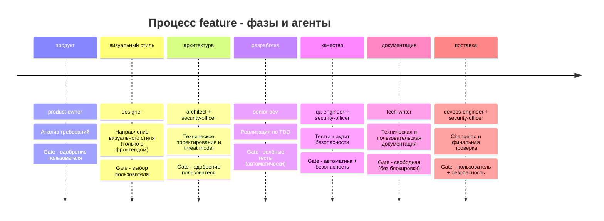

```text
█████╗ ██╗     ███████╗██████╗ ███████╗██████╗     ██████╗ ███████╗██╗   ██╗
██╔══██╗██║     ██╔════╝██╔══██╗██╔════╝██╔══██╗    ██╔══██╗██╔════╝██║   ██║
███████║██║     █████╗  ██████╔╝█████╗  ██║  ██║    ██║  ██║█████╗  ██║   ██║
██╔══██║██║     ██╔══╝  ██╔══██╗██╔══╝  ██║  ██║    ██║  ██║██╔══╝  ╚██╗ ██╔╝
██║  ██║███████╗██║     ██║  ██║███████╗██████╔╝    ██████╔╝███████╗ ╚████╔╝
╚═╝  ╚═╝╚══════╝╚═╝     ╚═╝  ╚═╝╚══════╝╚═════╝     ╚═════╝ ╚══════╝  ╚═══╝
```

> **Русский форк** [686f6c61/alfred-dev](https://github.com/686f6c61/alfred-dev). Промпты, хуки и вывод ядра переведены на русский. Агенты `selina` и `lucius` переименованы в `designer` и `cto`. Автор оригинального плагина: 686f6c61 (лицензия MIT сохранена). Форк: [grigoriev/alfred-dev](https://github.com/grigoriev/alfred-dev).

**Плагин автоматизированной программной инженерии для [Claude Code](https://code.claude.com/docs/en/overview).**

10 агентов (8 базовых, Designer при наличии фронтенда и CTO для готовой фичи), каталог из 11 процессных skills, постоянная память архитектурных решений по проекту, 6 процессов с проверяемыми по подтверждению quality gates, условная фаза визуального стиля, режим autopilot и европейский compliance (GDPR (RGPD), NIS2, CRA), встроенный с этапа проектирования.

[Документация оригинала (на испанском)](https://alfred-dev.com/) -- [Установка](#установка) -- [Команда](#команда) -- [Команды](#команды) -- [Архитектура](#архитектура)

---

## Что такое Alfred Dev

Alfred Dev: плагин, который оркестрирует цикл разработки ПО с помощью автономных агентов. У каждого агента своя роль, чёткая зона ответственности и quality gates, не дающие перейти к следующей фазе без подтверждения. Система устроена так, чтобы ни один артефакт не попал в production, не пройдя продукт, архитектуру, разработку с TDD, проверку безопасности, QA и документацию.

Рантайм определяет стек проекта через `config_loader.detect_stack()` (Node.js/TypeScript, Python, Rust, Go, Ruby, Elixir, Java/Kotlin, PHP, C#/.NET, Swift) и подстраивает артефакты под реальную экосистему: фреймворки, менеджеры пакетов, раннеры тестов и структуру каталогов, если эти манифесты существуют.

Живая документация проверяемого проекта лежит в `docs/project/` (индекс, архитектура, compliance, threat-model, зависимости, карта и состояние). ADR попадают в `docs/adr/`. Эти файлы не относятся к данному репозиторию: их создаёт плагин в репозитории, где ты работаешь.

## Команда

Alfred Dev не монолитный агент, который пытается знать всё. Это команда из **10 специалистов**: у каждого своя роль, свой характер и проверяемые по подтверждению quality gates. Универсальная модель работает лучше с конкретной ролью и сфокусированными инструкциями, чем когда от неё требуют быть всем сразу.

Каждый агент запускается как подпроцесс Claude Code через инструмент **Agent**. Он стартует со своим system prompt, без предвзятости и шума прошлых разговоров. Результат не обещается детерминированным, но он лучше управляем: та же роль, те же инструкции и те же артефакты снижают вариативность и упрощают проверку выполнения контракта.

Три принципа дизайна:

- **Единая ответственность.** Senior Dev пишет код; Security Officer проверяет безопасность. Никто не вторгается на чужую территорию.
- **Ограниченные инструменты.** Не всем агентам нужны файловая система или терминал. Ограничение инструментов уменьшает поверхность ошибок.
- **Quality gates между фазами.** Ни один артефакт не переходит в следующую фазу без контрольной точки. Gates бывают автоматическими (зелёные тесты), ручными (одобрение пользователя) или комбинированными (автоматика + безопасность).

Граница базового ядра:

- **`product-owner`** решает, **какую** проблему решаем и **зачем**.
- **`architect`** решает, **как** это реализуется технически.
- **`alfred`** решает, **когда** вмешивается каждый, в каком порядке и с какой gate.

Если смешать эти три ответственности, процесс перестаёт быть предсказуемым. Alfred координирует; он не переопределяет объём и дизайн по своей инициативе.

### Процесс feature: хронология фаз

Процесс `feature` самый полный: до семи последовательных фаз. Фаза `visual_style` появляется только если у проекта есть фронтенд. `security-officer` участвует в архитектуре, качестве и поставке: безопасность не последний шаг.



`security-officer` проверяет threat model на архитектуре, аудирует код на качестве и даёт добро на поставке. Найти проблему безопасности рано дешевле, чем найти её в production.

## Установка

Одна строка. Скрипт проверяет окружение, регистрирует в Claude Code глобальный источник GitHub для Alfred Dev и ставит плагин через нативный CLI Claude Code.
Он не трогает `~/.claude/skills`, не создаёт `~/.claude/skills/alfred/SKILL.md` и
`~/.claude/commands/alfred.md`. Точка входа: `/alfred-dev:alfred`.
Он патчит хуки и `.mcp.json`, если `python3` по умолчанию несовместим.

Перед установкой скрипт очищает локальный checkout маркетплейса
(`~/.claude/plugins/marketplaces/alfred-dev`) и регистрирует его заново, чтобы
не использовать устаревший кэш. Поддерживается только глобальная установка
на уровне пользователя: если остались следы `local` или `project` самого Alfred Dev, установщик
нормализует их и переустанавливает с `--scope user`. Официальный маркетплейс Anthropic не используется: нативный CLI регистрирует собственный неофициальный источник.

```bash
curl -fsSL https://raw.githubusercontent.com/grigoriev/alfred-dev/ru/install.sh | bash
```

Если репозиторий уже клонирован локально, можно запустить так:

```bash
bash ./install.sh
```

После установки в открытой сессии выполни `/reload-plugins`, чтобы загрузить
Alfred Dev без перезапуска. Если Claude Code предупреждает о стоимости/кэше MCP или
плагин не появился, перезапусти Claude Code. Проверка:

```bash
/alfred-dev:alfred
```

В Windows (PowerShell):

```powershell
irm https://raw.githubusercontent.com/grigoriev/alfred-dev/ru/install.ps1 | iex
```

Требования:

- Установленный, настроенный и обновлённый [Claude Code](https://code.claude.com/docs/en/overview). Alfred Dev 0.7.0 требует CLI с плагинами, skills, хуками и MCP.
- Python 3.10+ (для хуков, ядра и MCP в macOS, Linux и Windows).

Удаление:

```bash
# macOS / Linux
curl -fsSL https://raw.githubusercontent.com/grigoriev/alfred-dev/ru/uninstall.sh | bash
```

```bash
# macOS / Linux, из клонированного репозитория
bash ./uninstall.sh
```

```powershell
# Windows
irm https://raw.githubusercontent.com/grigoriev/alfred-dev/ru/uninstall.ps1 | iex
```

Деинсталлятор удаляет плагин и источник маркетплейса в scope `user`.
Если остался глобальный алиас `/alfred` от установок 0.6, он тоже очищается.
Каталог `.claude/` проекта (конфиг, память SQLite, handoff) не удаляется.

`/alfred-dev:update` сравнивает установленную версию с последним GitHub Release
и ведёт через обновление. Добавление маркетплейса `grigoriev/alfred-dev` ставит
то, что лежит в ветке по умолчанию `ru` (русская версия; `main` повторяет upstream).

## Быстрый старт

После установки говори по-русски. Запоминать slash-команды не нужно.

```text
продолжай с того места, где остановились
логин падает с кириллицей в имени
поменяй текст кнопки
```

Хук `prompt-route.py` предлагает маршрут, если в тексте нет slash. Русские фразы маршрутизируются этим хуком; испанские по-прежнему работают тоже. `/alfred-dev:alfred`
решает, что нужно: картировать, обсудить, продолжить, открыть UAT или запустить процесс.
Если нужен длинный процесс:

```text
/alfred-dev:feature система входа по email и паролю
```

`/alfred-dev:config` меняет автономность и CTO. `/alfred-dev:feature` проходит
до 7 фаз (продукт, визуальный стиль, архитектура, разработка, качество,
документация, поставка). Autopilot решает только настроенные пользовательские gates;
он не пропускает тесты, безопасность, подтверждение и ручное подтверждение развёртывания.
Фаза визуального стиля включается только при наличии интерфейса.

## Новое в v0.7.0

Сокращение под SDK Claude Code: 10 агентов (`inherit`), 11 плоских skills, 18 опубликованных команд. Точка входа: `/alfred-dev:alfred`. Публичная непрерывность: `alfred`, `progress` и `resume`. Без глобального алиаса `/alfred`, без stop-hook Ralph и без перезаписи `settings.json`. Сервер памяти использует современный MCP stdio и запускает `mcp/memory_server.py` с FastMCP, если установлен пакет `mcp`. Secret-guard покрывает Write, Edit, Bash и MCP-инструменты записи. Agent Teams только если пользователь уже включил их. Живой аудит: [docs/release.md](docs/release.md). История 0.6.x: [changelog](CHANGELOG.md).

## Команды

Весь интерфейс управляется из командной строки Claude Code. Главная точка входа: `/alfred-dev:alfred`. Остальные используют тот же префикс `/alfred-dev:`. Глобального алиаса `/alfred` нет. `plugin.json` публикует 18 команд. В `commands/` остаются внутренние хелперы, которые не перечислены как slash: `next`, `search`, `_composition.md` и `_living_docs.md`.

### Core

| Команда | Описание |
|---------|----------|
| `/alfred-dev:alfred` | Контекстный вход: решает, что нужно: картировать, обсудить, продолжить, открыть UAT или запустить мультиагентный процесс. |
| `/alfred-dev:feature <desc>` | Полный цикл до 7 фаз. Alfred спрашивает, с какой фазы начать. |
| `/alfred-dev:quick <desc>` | Лёгкий процесс для небольших изменений, меньше церемоний, чем в `feature`. |
| `/alfred-dev:fix <desc>` | Исправление багов в 3 фазы: диагностика, исправление по TDD, валидация. |
| `/alfred-dev:spike <тема>` | Техническое исследование без обязательств: прототипы, бенчмарки, выводы. |
| `/alfred-dev:discuss <desc>` | Уточняет идею или фазу и оставляет `docs/project/discovery.md` перед запуском `feature`. |
| `/alfred-dev:map-codebase` | Анализирует существующий репозиторий и создаёт `docs/project/codebase-map.md` и `docs/project/current.md`. |
| `/alfred-dev:progress` | Сводка по kanban, блокировкам, трассируемости, UAT и операционному состоянию. |
| `/alfred-dev:uat` | Создаёт или закрывает ручную валидацию, отдельную от автоматических тестов. |
| `/alfred-dev:audit` | Аудит четырьмя агентами параллельно: качество, безопасность, архитектура, документация. |
| `/alfred-dev:ship` | Релиз: финальный аудит, changelog, семантическое версионирование, развёртывание. |
| `/alfred-dev:memory-ui` | Открывает или закрывает локальный UI памяти SQLite. |
| `/alfred-dev:config` | Настройка автономности, стека, CTO, памяти и личности. |

### Операционные

| Команда | Описание |
|---------|----------|
| `/alfred-dev:resume` | Продолжает приостановленную сессию по handoff и сохранённому состоянию. |
| `/alfred-dev:pause` | Приостанавливает текущую работу и создаёт постоянный handoff. |
| `/alfred-dev:sync-github [owner/repo]` | Отражает локальную доску в GitHub Issues через `gh`. |
| `/alfred-dev:cto [dir] [--scope X]` | Внешнее ревью готовой фичи через Greptile CLI. |
| `/alfred-dev:update` | Проверяет наличие новой версии (GitHub Releases) и обновляет плагин. |

### Пример использования

```
> /alfred-dev:feature система аутентификации с OAuth2

Alfred запускает процесс до 7 фаз:
  1. Продукт          -- PRD с пользовательскими историями и критериями приёмки
  2. Визуальный стиль -- Три варианта в браузере (только если есть UI)
  3. Архитектура      -- Дизайн компонентов, ADR, threat model параллельно
  4. Разработка       -- Реализация по TDD (красный-зелёный-рефакторинг)
  5. Качество         -- Code review + OWASP + compliance + SBOM
  6. Документация     -- API docs, руководство пользователя, changelog
  7. Поставка         -- Пайплайн CI/CD, Docker, deploy

Каждый переход между фазами требует прохождения соответствующей quality gate.
```

6 процессов оркестратора: `feature` (до 7 фаз), `fix` (3), `spike` (2),
`ship` (4), `audit` (1) и `quick` (2).

## Архитектура

### Базовые агенты (8 + Designer)

Плагин публикует 10 агентов: 8 базовых, Designer при наличии фронтенда и CTO для готовой фичи. Конфигурация проекта не отключает ядро, но Alfred не вызывает всех сразу: каждый процесс активирует роль фазы, учитывая сигналы проекта и ожидающие gates. Kanban и трассируемость пишет рантайм, а не агент-проджект-менеджер.

| Агент | Роль | Модель | Ответственность |
|-------|------|--------|-----------------|
| **Alfred** | Оркестратор | inherit | Координирует процессы, активирует агентов, оценивает gates между фазами |
| **Product Owner** | Продукт | inherit | PRD, пользовательские истории, критерии приёмки, конкурентный анализ |
| **Designer** | Визуальное направление | inherit | Три варианта в браузере, артефакт `docs/style-direction.md`, gate стиля |
| **Architect** | Архитектура | inherit | Проектирование систем, ADR, диаграммы Mermaid, матрицы решений |
| **Senior Dev** | Разработка | inherit | Реализация по TDD, рефакторинг, атомарные коммиты |
| **Security Officer** | Безопасность | inherit | OWASP Top 10, threat modeling STRIDE, SBOM, compliance GDPR (RGPD)/NIS2/CRA |
| **QA Engineer** | Качество | inherit | Test plans, code review, исследовательское тестирование, интеграция, E2E, регрессия |
| **DevOps Engineer** | Поставка | inherit | Docker multi-stage, CI/CD, deploy, monitoring, observability |
| **Tech Writer** | Документация | inherit | Короткий sync по фазе (заголовки, docstrings, `docs/project/`); в фазе документации: API docs, архитектура, руководства, changelogs |

Все 10 агентов объявляют `model: inherit` и используют модель сессии. Designer занимает условную фазу между продуктом и архитектурой. Активируется только если `has_frontend(stack)` истинно.

### Опциональный агент (CTO)

Единственный опциональный агент рантайма: **CTO**, внешнее ревью готовой фичи через Greptile CLI. Он включён по умолчанию, но в процессах работает только на закрытии качества `feature` и на финальном аудите `ship`. В `quick`, `fix`, `spike` и `audit` он не участвует. `/alfred-dev:cto` запускает ревью вручную в любой момент. Выключить CTO можно через `/alfred-dev:config`. Нужны Greptile CLI, вход через `greptile login` и подключённый репозиторий. Нет data-engineer, ux-reviewer, github-manager и остального каталога 0.6. Подробнее в [документации по конфигурации](docs/configuration.md#динамический-состав-команды).

### Skills (11)

Каждый skill: плоская способность в `skills/*/SKILL.md`. Опубликованный каталог:

```
skills/
  compliance-check/
  evaluate-dependency/
  incident-response/
  memory/
  pr-workflow/
  sbom-generate/
  sonarqube/
  style-direction/
  sync-project-docs/
  threat-model/
  write-adr/
```

Skills с побочными эффектами (`style-direction`, `sonarqube`, `incident-response`, `pr-workflow`) объявляют `disable-model-invocation: true`.

### Хуки (10)

Хуки перехватывают события жизненного цикла Claude Code. Плагин регистрирует 10 скриптов на `SessionStart`, `SessionEnd`, `UserPromptSubmit`, `PreToolUse` и `PostToolUse`. `activity-capture.py` стоит в трёх matcher (всего 12 регистраций). Stop, UserPromptExpansion и PreCompact не регистрируются.

| Хук | Событие | Функция |
|-----|---------|---------|
| `session-bootstrap.sh` | `SessionStart` | Синхронный bootstrap: локальный конфиг, память, права и обёртка непрерывности |
| `session-start.sh` | `SessionStart` | Брифинг сессии, протокол общения без slash и контекст непрерывности |
| `session-end.py` | `SessionEnd` | Останавливает Memory UI и записывает закрытие сессии (fail-open) |
| `prompt-route.py` | `UserPromptSubmit` | Если в тексте нет slash, предлагает fix/quick/resume по запросу |
| `secret-guard.py` | `PreToolUse` (Write/Edit/Bash/MCP) | Блокирует запись секретов |
| `dangerous-command-guard.py` | `PreToolUse` (Bash) | Блокирует разрушительные команды (`rm -rf /`, force push, DROP DATABASE) |
| `sensitive-read-guard.py` | `PreToolUse` (Read) | Предупреждает при чтении чувствительных файлов (приватные ключи, `.env`, учётные данные) |
| `quality-gate.py` | `PostToolUse` (Bash) | Предупреждает, когда раннер тестов падает, по выводу и exit code |
| `evidence-guard.py` | `PostToolUse` (Bash) | Фиксирует подтверждение запуска тестов для проверки gates |
| `activity-capture.py` | `PostToolUse` + `UserPromptSubmit` | Автоматический захват активности, коммитов и итераций |

### Шаблоны (8)

Шаблоны, по которым агенты создают артефакты со стабильной структурой:

- `prd.md` -- Product Requirements Document
- `adr.md` -- Architecture Decision Record
- `test-plan.md` -- План тестирования по рискам
- `threat-model.md` -- Моделирование угроз STRIDE
- `sbom.md` -- Software Bill of Materials
- `changelog-entry.md` -- Запись changelog (Keep a Changelog)
- `release-notes.md` -- Заметки о релизе с кратким резюме
- `compliance.md` -- Чек-лист соответствия проекта

### Core Python

Ядро плагина написано на Python с юнит-тестами. Модули сгруппированы по
ответственности, чтобы не обещать фиксированное число, которое устареет
при росте рантайма:

| Семейство | Основные модули | Функция |
|-----------|-----------------|---------|
| Оркестрация | `orchestrator.py` | Конечный автомат 6 процессов, сессии, gates, autopilot, итеративный цикл |
| Личность | `personality.py` | Фразы, тон, анонсы и формат вердикта |
| Конфигурация | `config_loader.py`, `optional_agents.py`, `config_cli.py` | Загрузка конфига, определение стека, меню `/alfred-dev:config` и CTO |
| Непрерывность | `continuity.py`, `session_report.py`, `session_brief.py`, `hygiene.py` | Хелперы, пауза/возобновление, брифинг, гигиена ship и UAT |
| Живые доки | `project_docs.py` | Каркас и проверка `docs/project/` и `docs/adr/` |
| Маршрутизация | `prompt_route.py` | Классифицирует промпты без slash (fix, quick, resume, map-codebase) |
| Память | `memory.py`, `memory_config.py`, `memory_sync.py`, `memory_ui_server.py` | Локальный SQLite, sync Markdown и локальный GET UI |
| Безопасность | `secrets.py` | Санитизация и обнаружение секретов, используется памятью, упаковкой и guards |
| Визуал Designer | `selina_visual.py`, `selina_style_*.py` | Условное визуальное направление, каталог, варианты и селектор |

```bash
# Запуск тестов
python3 -m pytest tests/ -v
```

## Quality gates

Quality gates: проверяемые контрольные точки между фазами. Если условия gate не выполнены, процесс останавливается или остаётся в ожидании с понятным следующим действием. Autopilot решает только настроенные пользовательские gates; он не пропускает тесты, безопасность, подтверждение и ручное подтверждение развёртывания.

Оркестратор определяет 5 типов: `free`, `user`, `automatic`, `user+security` и `automatic+security`.

| Gate | Условие |
|------|---------|
| PRD одобрен | Пользователь утверждает PRD перед переходом к архитектуре |
| Дизайн одобрен | Пользователь одобряет дизайн И security officer его валидирует |
| Тесты зелёные | Все тесты проходят перед переходом к качеству |
| Подтверждение проверено | Утверждения о тестах должны опираться на реальный вывод, записанный `evidence-guard.py` |
| Итеративный цикл | Если gate не пройдена, повтор до 5 раз с обратной связью, затем эскалация пользователю |
| QA + безопасность | QA engineer и security officer одобряют параллельно |
| Документация полная | Все артефакты задокументированы, есть проверяемый чек-лист/подтверждение |
| Пайплайн зелёный | CI/CD зелёный, без root-пользователя в контейнере, без секретов в образе |

Каждая gate выдаёт формальный вердикт: **ОДОБРЕНО**, **ОДОБРЕНО С УСЛОВИЯМИ** или **ОТКЛОНЕНО**, с блокирующими находками и рекомендуемым следующим действием.

## Compliance

Плагин встраивает проверки европейского compliance в процесс разработки:

- **GDPR (RGPD)** -- Защита данных с этапа проектирования. Проверка правового основания, минимизация данных, права субъектов.
- **NIS2** -- Директива по кибербезопасности для основных операторов. Управление рисками, уведомление об инцидентах, цепочка поставок.
- **CRA** -- Cyber Resilience Act. Требования киберустойчивости для цифровых продуктов с подключёнными компонентами.
- **OWASP Top 10** -- Системная проверка 10 наиболее эксплуатируемых уязвимостей при каждом ревью безопасности.
- **SBOM** -- Автоматическая генерация Software Bill of Materials с перечнем зависимостей, лицензий и известных CVE.

## Определение стека

`core/config_loader.py` (`detect_stack()`) анализирует каталог проекта при загрузке конфигурации. Bootstrap `SessionStart` создаёт `.claude/alfred-dev.local.md` с этим результатом. `session-start.sh` этого не делает: этот хук вставляет брифинг и протокол общения без slash.

| Язык | Сигналы | Что определяется дополнительно |
|------|---------|-------------------------------|
| Node.js / TypeScript | `package.json` (+ `tsconfig.json` повышает до TypeScript) | Фреймворки: Next, Nuxt, Astro, Remix, Gatsby, Svelte, Solid, Qwik, Vue, React, Angular, Hono, Express, Fastify, Koa, Nest. ORM, раннер и бандлер, если есть в зависимостях. |
| Python | `pyproject.toml`, `setup.py`, `requirements.txt` | FastAPI, Django, Flask, Starlette, Litestar, Sanic, Tornado, aiohttp. ORM и раннер, если есть в манифестах. |
| Rust | `Cargo.toml` | Рантайм и язык. Фреймворк не выводится. |
| Go | `go.mod` | Рантайм и язык. Фреймворк не выводится. |
| Ruby | `Gemfile` | Рантайм и язык. Фреймворк не выводится. |
| Elixir | `mix.exs` | Рантайм и язык. Фреймворк не выводится. |
| Java / Kotlin | `pom.xml`, `build.gradle`, `build.gradle.kts` | Spring Boot, Quarkus, Micronaut. Kotlin, если есть `.kt` или Gradle Kotlin. |
| PHP | `composer.json` | Laravel, Symfony, Slim. |
| C# / .NET | `*.csproj`, `*.sln` | ASP.NET или Blazor. |
| Swift | `Package.swift` | Vapor, если указан в манифесте. |

Designer подключается только если определённый фреймворк входит во фронтенд-набор (Next, Nuxt, Astro, Remix, Gatsby, Svelte, Solid, Qwik, Vue, React, Angular).

## Постоянная память

Alfred Dev помнит решения, коммиты и итерации между сессиями. Память хранится в локальном SQLite (`.claude/alfred-memory.db`) внутри каждого проекта, без удалённых сервисов.

`load_config()` начинает с `memory.enabled: false`, если локального файла нет. В первой сессии `session-bootstrap.sh` создаёт `.claude/alfred-dev.local.md` с включённой памятью. После этого `/alfred-dev:config` может её отключить. Если память выключена, процессы продолжают работать; у будущих сессий не будет истории.

При включённой памяти `activity-capture.py` записывает события на `UserPromptSubmit` и `PostToolUse` (Write, Edit, Bash): итерации, фазы, коммиты (SHA, автор, файлы) и активность сессии. Решения запрашиваются через MCP-сервер и `/alfred-dev:memory-ui`.

Основные возможности:

- **Трассируемость**: проблема, решение, коммит и валидация связаны по ID.
- **Поиск**: полнотекстовый через FTS5, фильтры `since`/`until`, теги и статус (`active`/`superseded`/`deprecated`).
- **MCP-сервер** (`alfred-memory`): 15 инструментов (поиск, запись, запрос, статистика, итерации, жизненный цикл решений, целостность, export/import). Говорит на современном MCP stdio (JSON по строке) и сохраняет совместимое чтение старого фрейминга `Content-Length`.
- **Memory UI**: локальный GET-просмотрщик на loopback поверх `.claude/alfred-memory.db`. История Git при открытии не импортируется. `POST` не реализован. `/alfred-dev:memory-ui stop` и `SessionEnd` останавливают сервер.
- **Импорт MCP**: инструмент `memory_import` может загрузить коммиты Git или ADR из `docs/adr/`, когда его вызывает агент; при открытии UI этого не происходит.
- **Контекст сессии**: `session-start.sh` вставляет брифинг состояния, последнее решение и принятые ADR.
- **Экспорт**: `memory_export` записывает решения в Markdown в формате ADR.
- **Безопасность**: санитизация секретов по тем же шаблонам, что у `secret-guard.py`, права `0600` на базе данных.
- **Миграция**: схема обновляется с предварительным бэкапом при открытии старых баз.

## Структура проекта

```
alfred-dev/
  .claude-plugin/
    plugin.json           # Манифест плагина (version, 18 команд)
    marketplace.json      # Метаданные неофициального источника
  .mcp.json               # MCP-сервер alfred-memory (stdio)
  agents/                 # 10 агентов (8 базовых + Designer + CTO)
  commands/               # 18 опубликованных команд + внутренние хелперы
  skills/                 # Опубликованный каталог из 11 плоских skills
  hooks/                  # 10 скриптов + hooks.json
  core/                   # Движок оркестрации, памяти и отчётов (Python)
  mcp/                    # MCP stdio-сервер (постоянная память)
  templates/              # 8 шаблонов артефактов
  visual/                 # Локальный companion Designer (сервер и HTML)
  tests/                  # Тесты и контракты релиза (pytest)
  docs/                   # Техническая документация плагина
  scripts/                # Аудит релиза и smoke-проверки
  install.sh / install.ps1
  uninstall.sh / uninstall.ps1
```

Публичный лендинг оригинала ведётся в ветке `Alfred-Astro` апстрима и разворачивается из Coolify на VPS. Ветка `main` содержит только плагин, его рантайм и тесты.

## Конфигурация

Плагин настраивается по проекту через `.claude/alfred-dev.local.md` в корне проекта. В первой сессии `SessionStart` создаёт его, если файла нет, с автономностью по фазам `autonomous` и включённой памятью; затем `/alfred-dev:config` позволяет переключить на `interactive` или `semi-autonomous`. Единственный опциональный агент: CTO:

```yaml
---
autonomy:
  product: autonomous
  architecture: autonomous
  development: autonomous
  quality: autonomous
  documentation: autonomous
  delivery: autonomous

optional_agents:
  cto: true

memory:
  enabled: true
  sync_to_native: true
  sync_commits_limit: 10
  capture_decisions: true
  capture_commits: true
  retention_days: 365

personality:
  sarcasm_level: 3
  verbosity: normal
  language: ru
  celebrate_wins: true
  call_out_bad_practices: true
---

Дополнительные заметки по проекту, которые Alfred должен учитывать.
```

Три уровня автономности по фазам: `interactive` (запрашивает подтверждение), `semi-autonomous` и `autonomous`. Autopilot не пропускает тесты, безопасность, подтверждение и deploy.

## Отказ от ответственности

**Alfred Dev** (включая этот форк) независимый проект с открытым исходным кодом. Он не связан с **Anthropic** и командой **Claude Code**, не спонсируется и не одобряется ими.

Программное обеспечение предоставляется «как есть», без гарантий любого рода, явных или подразумеваемых, включая гарантии товарной пригодности, пригодности для конкретной цели и ненарушения прав. Ни при каких обстоятельствах авторы или правообладатели не несут ответственности по искам, за ущерб или иные обязательства, возникшие из использования программного обеспечения.

Alfred Dev запускает агентов, которые могут создавать, изменять и удалять файлы, выполнять команды в терминале и взаимодействовать с внешними сервисами (GitHub, Docker и т. д.). Пользователь отвечает за проверку и одобрение действий, которые предлагает плагин, до их выполнения.

Агенты используют языковые модели, которые могут генерировать неверный, неполный или неподходящий контент. Выводы плагина: предложения, требующие проверки человеком, а не окончательные результаты.

## Лицензия

MIT

---

[Документация оригинала (на испанском)](https://alfred-dev.com/) | [Исходный код форка](https://github.com/grigoriev/alfred-dev) | [Оригинал](https://github.com/686f6c61/alfred-dev)
