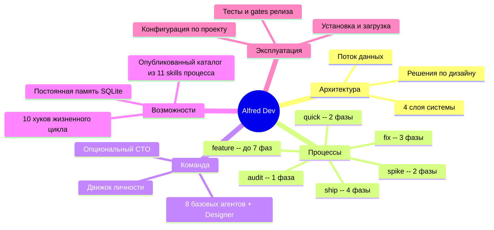

# Техническая документация Alfred Dev

Эта документация для разработчиков, которым нужно понять, как плагин Alfred Dev устроен внутри: его архитектуру, решения по дизайну, интеграцию с Claude Code и порядок внесения вклада. Это не пользовательская документация (она в [README проекта](../README.md) и на [landing page](https://alfred-dev.com/)); это техническая документация плагина.

`docs/` содержит только стабильную документацию, которая помогает понять, эксплуатировать и сопровождать Alfred Dev. Временные рабочие артефакты здесь не публикуются; версионированные отчёты о релизах лежат в этом каталоге, если они документируют подтверждения, полезные для сопровождения плагина.

Ветка `main` содержит плагин и его runtime. Публичная landing page живёт в ветке `Alfred-Astro` и разворачивается из Coolify на VPS.

Alfred Dev это плагин Claude Code с командой из 10 агентов (8 базовых, Designer при наличии фронтенда и CTO по запросу). У каждого агента своя роль и quality gates, проверяемые по подтверждению. Плагин организован в 4 слоя (команды, агенты, ядро на Python, интеграция), которые координируются через JSON-файл состояния и базу данных SQLite для постоянной памяти. Он публикует 11 skills процесса.

Исходный код остаётся окончательным источником истины, но эта документация объясняет, **почему** принято каждое решение: почему Python, а не JavaScript, почему SQLite, а не JSON, почему 10 агентов, а не один, почему quality gates на каждом переходе. Junior должен суметь прочитать эту документацию от начала до конца и понять проект без посторонней помощи.

---

## Карта проекта

---

## Навигация

Документация идёт от общего к частному. Рекомендуется читать в порядке таблицы, хотя каждый файл самодостаточен.

| Файл | Описание |
|------|----------|
| [architecture.md](architecture.md) | 4 слоя системы, диаграммы C4 и последовательностей, фундаментальные решения по дизайну |
| [flows.md](flows.md) | 6 процессов с диаграммами состояний, quality gates и форматом вердикта |
| [commands.md](commands.md) | Справочник по 18 командам, которые публикует плагин, сгруппированным по реальному использованию |
| [agents/README.md](agents/README.md) | Обзор команды из 10 агентов, модель совместной работы, распределение моделей |
| [skills.md](skills.md) | Каталог из 11 плоских skills и правила ручной активации самых чувствительных skills |
| [visual.md](visual.md) | Локальный визуальный runtime Designer: сервер, скрипты, события, hardening и упаковка |
| [hooks.md](hooks.md) | 10 скриптов хуков, которые связывают Alfred с Claude Code |
| [memory.md](memory.md) | Постоянная память: схема SQLite, FTS5, сервер MCP, очистка данных |
| [configuration.md](configuration.md) | Определение стека, файл .local.md, уровни автономности, опциональные агенты, динамический состав команды |
| [installation.md](installation.md) | Цепочка загрузки плагинов в Claude Code, скрипты установки, troubleshooting |
| [personality.md](personality.md) | Движок личности: фразы, сарказм, вердикты, распределение моделей |
| [testing.md](testing.md) | Тесты, воспроизводимые аудиты, smoke-тесты Claude CLI, проверка человеком и честные границы покрытия |
| [operations.md](operations.md) | Непрерывность, kanban, handoff, UAT, `docs/project/` и синхронизация с GitHub |
| [release.md](release.md) | Живой аудит 0.7.0: инвентарь, gates, ручная матрица и проверка человеком |
| [mcp.md](mcp.md) | Сервер памяти MCP, локальный Memory UI и как они сочетаются с SQLite и непрерывностью |
| [contributing.md](contributing.md) | Как менять промпты, runtime, документацию и релизы без расхождений |
| [repository.md](repository.md) | Карта репозитория: где живёт каждая подсистема и какой документ объясняет каждую зону |

### Карточки агентов

У каждого агента своя карточка: личность, обязанности, quality gate, взаимодействия и фразы.

| Агент | Прозвище | Тип |
|-------|----------|-----|
| [alfred.md](agents/alfred.md) | Alfred | Базовый |
| [product-owner.md](agents/product-owner.md) | Искатель проблем | Базовый |
| [architect.md](agents/architect.md) | Рисовальщик квадратиков | Базовый |
| [senior-dev.md](agents/senior-dev.md) | Ремесленник | Базовый |
| [security-officer.md](agents/security-officer.md) | Параноик | Базовый |
| [qa-engineer.md](agents/qa-engineer.md) | Ломатель | Базовый |
| [devops-engineer.md](agents/devops-engineer.md) | Сантехник | Базовый |
| [tech-writer.md](agents/tech-writer.md) | Переводчик | Базовый |
| [designer.md](agents/designer.md) | Designer: Стилист | Базовый (при наличии фронтенда) |
| [cto.md](agents/cto.md) | CTO: Внешний технический директор | Опциональный |

---

## С чего начать

Порядок чтения зависит от того, что тебе нужно:

**Я новичок в проекте и хочу понять, как он работает.** Начни с [architecture.md](architecture.md), чтобы увидеть общую картину, затем [flows.md](flows.md), чтобы понять, как выполняются процессы. Потом прочитай [agents/README.md](agents/README.md), чтобы познакомиться с командой.

**Я хочу внести вклад в плагин.** Прочитай [architecture.md](architecture.md), чтобы понять слои, а затем [testing.md](testing.md), чтобы узнать, как запускать и писать тесты. Загляни в [hooks.md](hooks.md), если будешь менять слой интеграции, или в [personality.md](personality.md), если будешь добавлять агента.

**Я хочу сопровождать или публиковать изменения без расхождений.** Прочитай [contributing.md](contributing.md). Там кратко описано, какие поверхности нужно выровнять, когда ты меняешь промпты, манифесты, установщики, документацию или версию.

**Я хочу быстро сориентироваться в репозитории.** Начни с [repository.md](repository.md), чтобы узнать, в каком каталоге живёт каждая подсистема. Потом переходи к [commands.md](commands.md), если нужна опубликованная операционная поверхность, или к [architecture.md](architecture.md), если нужен взгляд на дизайн.

**Я хочу понять архитектуру и решения по дизайну.** Прочитай [architecture.md](architecture.md) от начала до конца. Разделы о решениях по дизайну объясняют логику каждого технического выбора. Дополни это [memory.md](memory.md) о системе памяти и [installation.md](installation.md) о цепочке загрузки плагинов.

**Я хочу добавить нового агента.** Прочитай [agents/README.md](agents/README.md), чтобы понять разницу между базовыми и опциональными агентами, затем любую карточку агента как образец структуры (например, [agents/qa-engineer.md](agents/qa-engineer.md)). Загляни в [personality.md](personality.md), чтобы понять, как работает движок личности и как зарегистрировать агента в `personality.py`.

**Я хочу настроить Alfred для своего проекта.** Прочитай [configuration.md](configuration.md) обо всех доступных опциях: определение стека, уровни автономности, опциональные агенты, постоянная память и личность.

**Я хочу понять непрерывную эксплуатацию плагина.** Прочитай [operations.md](operations.md), а затем [mcp.md](mcp.md). Там описана связь между непрерывностью, `docs/project/`, памятью, поиском и локальным UI.

---

## Соглашения этой документации

- **Язык**: русский. Устоявшиеся термины (handoff, gate, quality gate, UAT, PRD, ADR, kanban) остаются на английском.
- **Без эмодзи**: вместо них используются типографские маркеры.
- **Сначала абзацы**: каждый раздел начинается с поясняющих абзацев, которые дают контекст, прежде чем переходить к таблицам, спискам или диаграммам.
- **Диаграммы Mermaid**: используются нестандартные типы (C4Context, stateDiagram-v2, journey, mindmap, erDiagram, quadrantChart, timeline, sequenceDiagram с boxes) для максимальной выразительности.
- **Ссылки на код**: технические данные (имена переменных, значения по умолчанию, regex-шаблоны) берутся прямо из исходного кода и цитируются с путём к файлу.
- **Имя репозитория**: `alfred-dev` (не использовать `Claude-JARVIS-dev` и `jarvis-dev`).
