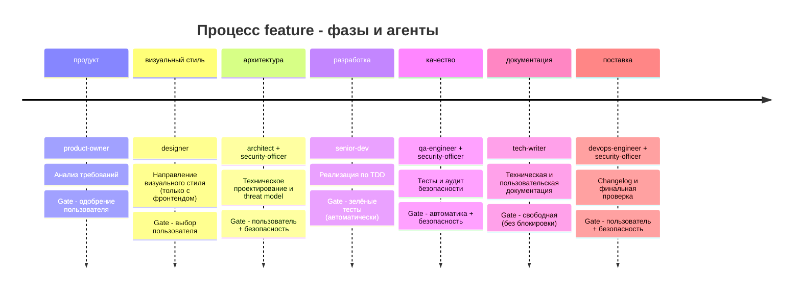

# Команда

Alfred Dev не монолитный агент, который пытается всё знать и всё делать. Это команда из **10 специалистов** (8 базовых, Designer при наличии фронтенда и CTO для готовой фичи). У каждого чётко очерченная роль, ограниченные инструменты, собственная личность и quality gates, проверяемые по подтверждению. Это решение по дизайну следует фундаментальному принципу: универсальная модель ИИ работает лучше, когда ей дают конкретную роль со сфокусированными инструкциями, чем когда от неё требуют быть всем сразу.

Каждый агент запускается как подпроцесс Claude Code через инструмент **Agent**. Это обеспечивает изоляцию контекста: агент стартует со своим system prompt, не наследуя предвзятость и шум прошлых разговоров. Результат не обещается детерминированным, но он лучше управляем: та же роль с теми же инструкциями и артефактами снижают вариативность и упрощают проверку, выполнил ли агент свой контракт.

Философию этой архитектуры можно свести к трём принципам:

- **Единая ответственность.** У каждого агента ясная зона действия. Ремесленник пишет код; Параноик аудирует безопасность. Никто не вторгается на чужую территорию.
- **Ограниченные инструменты.** Не всем агентам нужен доступ к файловой системе или терминалу. Ограничение инструментов для каждого агента уменьшает поверхность ошибок и заставляет специализироваться.
- **Quality gates между фазами.** Ни один артефакт не переходит из одной фазы в следующую, не пройдя контрольную точку. Gates бывают автоматическими (зелёные тесты), ручными (одобрение пользователя) или комбинированными (автоматика + безопасность).

В ядре есть особенно важная граница:

- **`product-owner`** решает, **какую** проблему решаем и **зачем**.
- **`architect`** решает, **как** это реализуется технически.
- **`alfred`** решает, **когда** вмешивается каждый, в каком порядке и с какой gate.

Если смешать эти три ответственности, процесс перестаёт быть предсказуемым. Поэтому Alfred координирует, но не переопределяет объём и дизайн по своей инициативе.

---

## Процесс feature: хронология фаз

Процесс `feature` самый полный в системе и лучше всех показывает, как агенты работают вместе. Каждая новая feature проходит **до семи** последовательных фаз: визуальная фаза `visual_style` появляется, только если у проекта есть фронтенд. Security-officer участвует в трёх разных фазах, потому что безопасность не финальный шаг, а сквозная забота, которая сопровождает разработку от дизайна до поставки.

Диаграмма показывает важную вещь: безопасность проверяется не в конце, а участвует в архитектуре (чтобы проверить threat model), в качестве (чтобы проаудировать код) и в поставке (чтобы дать финальное добро). Такое сквозное участие security-officer сделано намеренно: проблемы безопасности нужно находить как можно раньше, пока исправлять их дёшево.

---

## Сводная таблица агентов

10 агентов делятся на базовые (8), Designer (фронтенд) и CTO (опциональный). Таблица ниже даёт быстрый обзор каждого с основными характеристиками.

### Базовые агенты

Эти базовые агенты и Designer доступны по умолчанию, и конфигурация проекта их не отключает. Alfred не вызывает их всех сразу: каждый процесс активирует роль, которая соответствует фазе, а Designer подключается, только если есть пользовательский интерфейс.

| Агент | Прозвище | Модель | Тип | Цвет | Основная фаза |
|-------|----------|--------|-----|------|---------------|
| `alfred` | Alfred | opus | базовый | синий | оркестрация |
| `product-owner` | Искатель проблем | opus | базовый | зелёный | продукт |
| `architect` | Рисовальщик квадратиков | opus | базовый | cyan | архитектура |
| `senior-dev` | Ремесленник | opus | базовый | жёлтый | разработка |
| `security-officer` | Параноик | opus | базовый | красный | безопасность (сквозная) |
| `qa-engineer` | Ломатель | sonnet | базовый | пурпурный | качество |
| `devops-engineer` | Сантехник | sonnet | базовый | оранжевый | поставка |
| `tech-writer` | Переводчик | sonnet | базовый | белый | документация |
| `designer` | Designer: Стилист | opus | базовый | фиолетовый | визуальный стиль (фаза 1b) |

### Опциональный агент

CTO единственный опциональный специалист. Он выключен по умолчанию. Если его включить, он работает только на закрытии готовой фичи в `feature` и `ship`, а также по запросу через `/alfred-dev:cto`.

| Агент | Прозвище | Модель | Тип | Цвет | Основная фаза |
|-------|----------|--------|-----|------|---------------|
| `cto` | CTO: Внешний технический директор | opus | опциональный | янтарный | внешний технический аудит |

---

## Базовые и опциональные

Разделение на базовых и опциональных агентов не произвольно. Оно отвечает на практический вопрос: что нужно *любому* программному проекту, а что нужно только *некоторым*.

**Восемь базовых агентов и Designer** всегда есть в базовой команде, потому что покрывают универсальные фазы разработки: определить, что строим (product-owner), задать визуальное направление, если есть фронтенд (designer), решить, как строим (architect), построить (senior-dev), проверить, что работает (qa-engineer), задокументировать (tech-writer), развернуть (devops-engineer), защитить (security-officer) и оркестровать всё это (alfred). Kanban пишет runtime. Это не значит, что все участвуют в каждом ответе: Alfred вызывает их из команд плагина (`feature.md`, `fix.md`, `spike.md` и т. д.) в зависимости от фазы, сигналов проекта и gates. Claude Code находит их напрямую в `agents/`; манифест `plugin.json` не объявляет ручную секцию `agents`.

**Единственный опциональный агент**: cto, внешнее ревью готовой фичи через Greptile CLI. Claude Code находит агентов плагина напрямую в `agents/`; манифест не поддерживает ручную секцию `agents`. Локальная конфигурация проекта (`.local.md`) решает, входит ли CTO в автоматическую оркестрацию. По умолчанию `optional_agents.cto: true`, и CTO входит только в фазы `quality` процесса `feature` и `final_audit` процесса `ship`.

Итого: базовые доступны всегда, потому что без них не обойтись; опциональный CTO подключается только там, где нужен взгляд со стороны на готовую фичу.

---

## Модель совместной работы

Агенты Alfred Dev не общаются друг с другом напрямую. Между ними нет канала сообщений и нет вызовов от агента к агенту. Весь поток информации идёт через два механизма:

**Состояние сессии** (`alfred-dev-state.json`) это JSON-файл, который фиксирует, в какой фазе находится процесс, какие фазы завершены, какие артефакты созданы и каков результат каждой gate. Когда агент заканчивает работу, оркестратор обновляет состояние и по результату gate решает, можно ли перейти к следующей фазе.

**Артефакты** это результаты, которые производит каждый агент: документы требований, архитектурные диаграммы, исходный код, отчёты о тестах, changelogs или документация. Каждый артефакт регистрируется в состоянии сессии с именем и моментом создания. Агент следующей фазы получает в контекст релевантные артефакты прошлых фаз, но не историю разговора этих фаз.

**Alfred** (оркестратор) единственный агент с глобальным видением. Он знает весь процесс, знает, в какой фазе сессия, оценивает gates и решает, какого агента вызвать дальше и с каким контекстом. Остальные агенты специалисты, которые не видят общей картины: они получают конкретную задачу, выполняют её и возвращают результат. Это разделение намеренное: оно не даёт агенту принимать решения, которые ему не принадлежат.

Упрощённо процесс работает так:

1. Пользователь запускает команду (например, `/alfred-dev:feature`).
2. Alfred создаёт сессию и запускает первую фазу.
3. Alfred вызывает нужного агента через Agent и передаёт ему system prompt и релевантные артефакты.
4. Агент выполняет работу и возвращает результат.
5. Alfred оценивает gate фазы по результату.
6. Если gate пройдена, Alfred переходит к следующей фазе и повторяет с шага 3.
7. Если gate не пройдена, Alfred сообщает пользователю и ждёт исправления или одобрения.

---

## Распределение моделей

Все 10 агентов используют `model: opus`. Alfred, Architect, QA Engineer и Security Officer дополнительно объявляют `effort: high`.

Семь агентов на **opus** принимают критические решения:

| Агент | Почему opus |
|-------|-------------|
| `alfred` | Оркестрирует всю систему; нужно глубокое понимание контекста и способность принимать решения. |
| `product-owner` | Определяет требования и функциональный объём; ошибка здесь распространяется на весь процесс. |
| `architect` | Проектирует архитектуру; решения по дизайну трудно откатить. |
| `senior-dev` | Пишет production-код; качество кода прямо пропорционально возможностям модели. |
| `security-officer` | Оценивает угрозы и уязвимости; ложноотрицательный результат здесь имеет серьёзные последствия. |
| `designer` | Определяет визуальное направление и дизайн-систему в проектах с UI; его решения влияют на итоговый опыт пользователя. |
| `cto` | Координирует внешнее ревью через Greptile CLI; нужно глубокое рассуждение, чтобы свести отчёт и решить, какие предписания выполнимы. |

Остальные тринадцать агентов используют **sonnet**: он быстрее и дешевле. Их задачи, хотя и важные, более структурированы: запускать тесты и сообщать результаты (qa-engineer), генерировать документацию по существующим артефактам (tech-writer), управлять пайплайнами (devops-engineer) или выполнять проверки в узкой области (ux-reviewer, seo-specialist и т. д.). Sonnet надёжно решает эти задачи и ускоряет процессы, не жертвуя качеством там, где оно не критично.

---

## Почему Agent, а не прямой вызов

Агенты находятся в каталоге `agents/` и используются в основном как субагенты, которых команды плагина запускают через инструмент **Agent** Claude Code. У этого решения три фундаментальных преимущества:

**Изоляция контекста.** Каждый агент стартует с чистым контекстом: его system prompt и артефакты, которые передаёт Alfred. Он не наследует накопленный разговор сессии и контекст других агентов. Это предотвращает типичную проблему мультиагентных систем: перекрёстное загрязнение, когда инструкции или предвзятость одного агента влияют на следующего.

**Контроль инструментов.** Каждый вызов Agent может ограничить инструменты, доступные субагенту. Tech-writer не нужен терминал; qa-engineer не нужно писать production-файлы. Ограничение инструментов уменьшает поверхность случайных ошибок и заставляет каждого агента работать в своей зоне.

**Параллелизм.** Инструмент Agent позволяет запускать два и более субагентов параллельно. В текущем runtime параллелизм используется в основном в архитектуре и качестве процесса `feature`, в валидации `fix`, в исследовании `spike` и в аудитах `ship` и `audit`. Фаза `delivery` процесса `feature` держит двух агентов, но в `core/orchestrator.py` она не моделируется как параллельная.

---

## Навигация

У каждого агента есть отдельная карточка с полным system prompt, доступными инструментами, quality gates, которые он оценивает, и примерами взаимодействия. Таблица ниже ссылается на все карточки.

| Агент | Карточка | Описание |
|-------|----------|----------|
| `alfred` | [alfred.md](alfred.md) | Общий оркестратор системы; управляет сессиями, процессами и делегированием. |
| `product-owner` | [product-owner.md](product-owner.md) | Определяет функциональные требования, пользовательские истории и критерии приёмки. |
| `architect` | [architect.md](architect.md) | Проектирует техническую архитектуру, выбирает паттерны и проверяет реализуемость дизайна. |
| `senior-dev` | [senior-dev.md](senior-dev.md) | Реализует production-код по строгому TDD и принципам clean code. |
| `security-officer` | [security-officer.md](security-officer.md) | Сквозной аудит безопасности: threat model, code review и финальная проверка. |
| `qa-engineer` | [qa-engineer.md](qa-engineer.md) | Запускает и проектирует тесты; ищет edge cases и регрессии. |
| `devops-engineer` | [devops-engineer.md](devops-engineer.md) | Управляет CI/CD, пайплайнами, развёртываниями и упаковкой релизов. |
| `tech-writer` | [tech-writer.md](tech-writer.md) | Создаёт понятную сообществу техническую и пользовательскую документацию. |
| `designer` | [designer.md](designer.md) | Определяет визуальное направление продукта и закрывает фазу 1b, если есть фронтенд. |
| `cto` | [cto.md](cto.md) | Внешнее ревью готовой фичи через Greptile CLI; диагноз и предписание по каждому пункту. |
