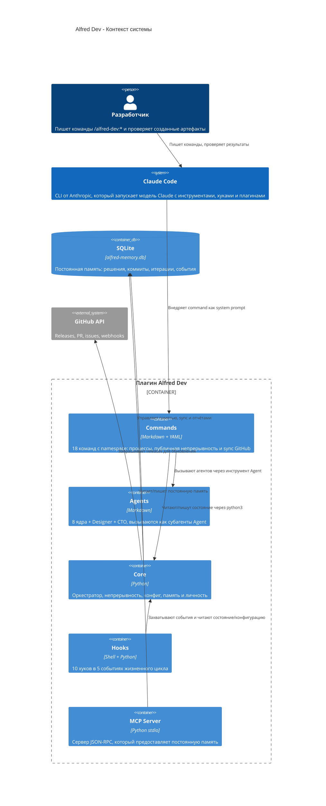
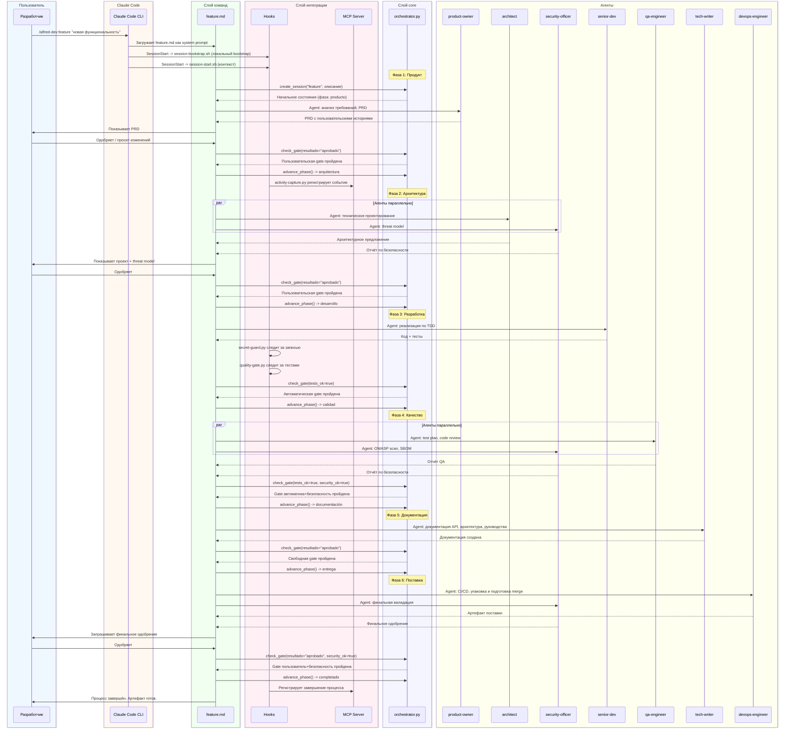
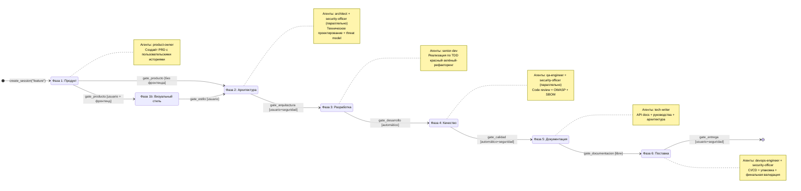

# Архитектура системы

Этот документ описывает, как Alfred Dev устроен внутри: его слои, проектные решения и путь данных от момента, когда пользователь пишет команду, до создания итогового артефакта. Это центральная часть технической документации плагина. Она написана так, чтобы любой разработчик, включая junior-разработчиков, которые приходят в проект, мог понять всю структуру без посторонней помощи.

Alfred Dev: плагин для Claude Code, который реализует виртуальную команду программной инженерии. Плагин не отдельное приложение: он работает внутри экосистемы Claude Code и использует её встроенные возможности (инструменты, субагенты, хуки, MCP), чтобы оркестрировать полные процессы разработки. Архитектура состоит из четырёх слоёв с чётко разграниченными зонами ответственности. Каждый слой зависит только от предыдущего и никогда наоборот.

---

## Четыре слоя системы

Архитектура Alfred Dev следует модели слоёв, где взаимодействие всегда идёт сверху вниз. У каждого слоя ясная ответственность и свой формат файлов. Такое разделение позволяет менять один слой, не затрагивая остальные, если соблюдается интерфейс между ними.

### Слой команд (`commands/*.md`)

Команды: точка входа пользователя в систему. Когда кто-то пишет `/alfred-dev:feature`, `/alfred-dev:fix` или любую другую команду, Claude Code ищет соответствующий Markdown-файл в каталоге `commands/` и внедряет его в разговор как system prompt. Значит, команды не исполняемые скрипты: это инструкции на естественном языке, которые шаг за шагом говорят Claude, что делать, каких агентов вызывать и в каком порядке.

У каждого файла команды две части: YAML frontmatter с метаданными (описание команды, подсказка по аргументу) и тело Markdown с инструкциями процесса. Frontmatter позволяет Claude Code показывать контекстную справку; тело определяет фазы, gates и правила, которые нельзя пропустить.

В плагине 18 команд, зарегистрированных в `plugin.json`. Контекстный вход: `/alfred-dev:alfred`:

| Команда | Файл | Назначение |
|---------|------|------------|
| `/alfred-dev:alfred` | `alfred.md` | Контекстный вход: решает, какой шаг следующий |
| `/alfred-dev:progress` | `progress.md` | Операционное состояние, kanban и трассируемость |
| `/alfred-dev:retomar` | `retomar.md` | Продолжает приостановленную сессию |
| `/alfred-dev:pause` | `pause.md` | Ставит работу на паузу и оставляет handoff |
| `/alfred-dev:map-codebase` | `map-codebase.md` | Brownfield-картирование репозитория |
| `/alfred-dev:discuss` | `discuss.md` | Предварительное уточнение и постоянный discovery |
| `/alfred-dev:memory-ui` | `memory-ui.md` | Локальный UI памяти SQLite |
| `/alfred-dev:ajustes` | `ajustes.md` | Настройка плагина |
| `/alfred-dev:uat` | `uat.md` | Ручная валидация |
| `/alfred-dev:sync-github` | `sync-github.md` | Зеркало локальной доски в GitHub Issues |
| `/alfred-dev:quick` | `quick.md` | Лёгкий процесс |
| `/alfred-dev:feature` | `feature.md` | Полный цикл feature |
| `/alfred-dev:fix` | `fix.md` | Диагностика и исправление багов |
| `/alfred-dev:spike` | `spike.md` | Исследовательская работа |
| `/alfred-dev:ship` | `ship.md` | Релиз и развёртывание |
| `/alfred-dev:audit` | `audit.md` | Параллельный аудит |
| `/alfred-dev:cto` | `cto.md` | Внешнее второе мнение |
| `/alfred-dev:update` | `update.md` | Обновление плагина |

Опубликованный контекстный вход: `/alfred-dev:alfred`. Установщик не
создаёт глобальный алиас `/alfred` и не перезаписывает `~/.claude/skills`. `next` и `search`
лежат в `commands/` как внутренние хелперы и не входят в `plugin.json`.

### Слой агентов (`agents/*.md`)

Агенты: специализированные system prompts, которые Claude Code запускает как субагенты через инструмент Agent. У каждого агента своя роль в виртуальной команде, инструменты, ограниченные его зоной действия, и собственная личность, которая подстраивается под уровень сарказма, заданный пользователем.

Ключевое различие в этом слое: разделение между ядром и единственным опциональным агентом. 8 агентов ядра и Designer (если есть фронтенд) участвуют в процессах: когда `feature.md` говорит «активируй агента product-owner», Claude Code создаёт субагента Agent, чей system prompt равен содержимому `agents/product-owner.md`. CTO включён по умолчанию, но в процессах подключается только на закрытии готовой фичи: в фазе `calidad` процесса `feature` и в фазе `auditoria_final` процесса `ship`. Вручную его запускает `/alfred-dev:cto`.

**Агенты ядра** (8 + Designer):

| Агент | Прозвище | Роль |
|-------|----------|------|
| `alfred` | Alfred | Руководитель операций / Оркестратор |
| `product-owner` | Искатель проблем | Product Owner |
| `architect` | Рисовальщик коробок | Архитектор |
| `senior-dev` | Мастер | Senior dev |
| `security-officer` | Параноик | CSO |
| `qa-engineer` | Ломатель | QA |
| `devops-engineer` | Сантехник | DevOps |
| `tech-writer` | Переводчик | Tech Writer |
| `designer` | Стилист | Визуальное направление, если есть фронтенд |

**Опциональный агент** (1):

| Агент | Прозвище | Роль |
|-------|----------|------|
| `cto` | Внешний технический директор | Внешнее техническое второе мнение |

### Слой core (`core/*.py`)

Слой core содержит чистую бизнес-логику плагина на Python. У этих модулей нет прямой зависимости от Claude Code: это функции и классы, которые получают данные, обрабатывают их и возвращают результат. Они запускаются через `python3 -c` из хуков или импортируются сервером MCP.

Слой core не один большой модуль, а семейство специализированных модулей. Самые важные на сегодня:

- **`orchestrator.py`** -- Конечный автомат, который определяет 6 процессов работы (feature, fix, spike, ship, audit, quick), у каждого свои последовательные фазы и quality gates. Оркестратор управляет созданием сессий, оценкой gates и переходом между фазами. Состояние хранится в плоском JSON-файле (`.claude/alfred-dev-state.json`). С v0.3.6 `run_flow()` может внедрить временную команду (`equipo_sesion`), созданную динамическим составом. Если явная команда не передана, он автоматически берёт сохранённую команду проекта из `.claude/alfred-dev.local.md`, чтобы runtime и конфигурация не расходились (см. [configuration.md](configuration.md#динамический-состав-команды)).

- **`config_loader.py`** -- Загрузчик конфигурации. Он читает настройки пользователя из файла `.local.md` с YAML frontmatter и автоматически определяет технологический stack проекта (runtime, язык, framework, ORM, раннер тестов, bundler). Содержит простой YAML-парсер как запасной вариант для окружений без PyYAML. Его вывод объединяется с `suggest_optional_agents()` и каноническим каталогом из `optional_agents.py`, чтобы рекомендовать специалистов по реальным признакам проекта без дублирования списков между runtime и динамическим составом. Также он предоставляет канонические builders сохранённой `equipo_sesion`, чтобы `run_flow()` и хелперы вроде `quick` стартовали с одной и той же рабочей командой, и даёт структурированный UX `/alfred-dev:ajustes` через `build_config_section_summaries()`, `build_config_section_menu()`, `apply_config_section_update()`, `build_config_section_change_preview()`, `update_config_section()` и `update_project_config_section()`.
- **`optional_agents.py`** -- Канонический каталог единственного опционального агента (`cto`). Централизует группу `Аудит`, видимые labels, специализацию и интеграцию по фазам, а также builders меню (`build_optional_agent_group_menu()` / `build_optional_agent_group_menus()`), чтобы `ajustes` и динамический состав не зависели от списков, написанных вручную.

- **`continuity.py`** -- Детерминированный слой операционной непрерывности. Публичная поверхность использует `map-codebase`, `discuss`, `pause`, `progress`, `retomar`, `uat` и `sync-github`. Внутренние хелперы `next` и `search` не публикуются. Runtime также реализует resume/verify/standup/validate для этих хелперов и для `progress`. Сохраняет `current.md`, `handoff.md`, `uat.md` и `github-sync.md`. Как внутренний хелпер обслуживания он также предоставляет `normalize-kanban` для унаследованных досок.
- **`memory.py`, `memory_sync.py`, `memory_ui_server.py`** -- Подсистема постоянной памяти: SQLite, поиск, санитизация, sync в нативные памяти и локальный UI.
- **`memory_config.py`** -- Лёгкий парсер секции `memoria` локального frontmatter. Позволяет хукам, sync и серверу MCP применять одну и ту же эффективную конфигурацию без дублирования логики.
- **`personality.py`** -- Движок личности, который задаёт идентичность, голос и характерные фразы каждого агента. Тон подстраивается под настраиваемый уровень сарказма (1 = профессиональный, 5 = едкий). На высоких уровнях в репертуар каждого агента добавляются колкие фразы.
- **`session_report.py`** -- Создание отчётов сессии в `docs/alfred-reports/` при закрытии или прерывании процессов.
- **`selina_*`** -- Визуальный runtime Designer: каталог стилей, пошаговый селектор, итоговое направление, варианты и поддержка рендеринга.

### Слой интеграции (`hooks/`, `mcp/`)

Слой интеграции: мост между Alfred Dev и жизненным циклом Claude Code. Предыдущие слои определяют «что делать», а этот слой определяет «когда это делать» и «как связываться с внешним миром».

**Хуки** (10 зарегистрированных скриптов, 5 событий жизненного цикла):

Хуки: скрипты, которые Claude Code запускает автоматически при определённых событиях. Они регистрируются в `hooks/hooks.json`; `matcher` необязателен и объявляется только в событиях, где Claude Code его поддерживает. В событиях вроде `Stop` и `UserPromptSubmit` Alfred не объявляет `matcher`, потому что Claude Code его игнорирует. В `UserPromptExpansion` Alfred тоже опускает `matcher`, чтобы покрыть все slash-команды и развёрнутые MCP-промпты, хотя Claude Code уже позволяет фильтровать по `command_name`. В `PreCompact` Alfred опускает `matcher`, чтобы покрыть и ручную, и автоматическую компактизацию. Этот плагин не регистрирует Stop, UserPromptExpansion и PreCompact.

| Хук | Событие | Matcher | Функция |
|-----|---------|---------|---------|
| `session-bootstrap.sh` | SessionStart | startup, resume, clear, compact, fork | Синхронный bootstrap проекта до первого промпта |
| `session-start.sh` | SessionStart | startup, resume, clear, compact, fork | Внедряет контекст проекта в начале сессии |
| `session-end.py` | SessionEnd | (нет) | Закрывает Memory UI и записывает закрытие сессии |
| `prompt-route.py` | UserPromptSubmit | (нет) | Предлагает fix/quick/retomar, если в тексте нет slash |
| `secret-guard.py` | PreToolUse | Write, Edit, Bash, mcp__.* | Блокирует запись секретов |
| `dangerous-command-guard.py` | PreToolUse | Bash | Блокирует разрушительные команды |
| `sensitive-read-guard.py` | PreToolUse | Read | Предупреждает при чтении файлов с учётными данными |
| `quality-gate.py` | PostToolUse | Bash | Следит за результатами тестов после выполнения команд |
| `evidence-guard.py` | PostToolUse | Bash | Фиксирует реальное подтверждение запуска тестов для автоматических gates |
| `activity-capture.py` | PostToolUse + UserPromptSubmit | (несколько) | Захватывает решения, gates, handoffs, UAT и коммиты сессии |

**Сервер MCP** (1 файл):

Файл `mcp/memory_server.py` реализует сервер MCP (Model Context Protocol) поверх stdio, который предоставляет постоянную память проекта. Claude Code запускает этот процесс в начале сессии и держит его живым. Сервер говорит на JSON-RPC 2.0 поверх stdio в текущем формате MCP (одно JSON-сообщение на строку), сохраняет совместимое чтение исторического framing `Content-Length` и предоставляет 15 инструментов:

| Инструмент MCP | Назначение |
|----------------|------------|
| `memory_search` | Текстовый поиск по решениям, коммитам и событиям с содержимым (FTS5 или LIKE) |
| `memory_log_decision` | Регистрирует формальное проектное решение |
| `memory_log_commit` | Регистрирует коммит и связывает его с решениями |
| `memory_get_iteration` | Получает данные итерации (или активной) |
| `memory_get_timeline` | Хронология событий итерации |
| `memory_stats` | Общая статистика памяти |
| `memory_manage_iteration` | Начинает или завершает итерации из MCP |
| `memory_log_event` | Регистрирует произвольные события хронологии |
| `memory_get_decisions` | Список решений с фильтрами по итерации, тегам или статусу |
| `memory_purge` | Удаляет старые события по правилу хранения |
| `memory_update_decision` | Обновляет статус или метки решения |
| `memory_link_decisions` | Создаёт связи между решениями |
| `memory_health` | Проверяет целостность и состояние памяти |
| `memory_export` | Экспортирует решения в Markdown в стиле ADR |
| `memory_import` | Импортирует историю из Git или ADR |

---

## Общий вид системы

Диаграмма C4 ниже показывает связи между основными участниками и контейнерами системы. Цель: дать взгляд с высоты птичьего полёта: кто с кем говорит и где идут данные.

---

## Полный процесс `/alfred-dev:feature`

Процесс feature самый полный в системе: 6 базовых фаз и условная фаза 1b визуального стиля, с gates между ними, несколькими агентами и координацией между хуками, core и MCP. На практике это процесс до 7 фаз. Диаграмма последовательности ниже показывает весь путь от момента, когда пользователь пишет команду, до создания итогового результата.

Важно понимать, что этот процесс не скрипт, который выполняется за один раз: каждая фаза это разговор между Claude и пользователем, где агенты вносят свою экспертизу, а gates определяют, можно ли идти дальше. Оркестратор хранит состояние, чтобы процесс можно было продолжить после прерывания.

---

## Проектные решения

Этот раздел описывает самые важные архитектурные решения плагина и причины каждого из них. Понимать «почему» так же важно, как понимать «что»: когда кому-то понадобится что-то изменить, он будет знать, какие ограничения определили исходный выбор, и сможет оценить, действуют ли они до сих пор.

### Почему Python, а не JavaScript для core

Выбор Python для слоя core не случаен. Python предустановлен в macOS и в большинстве дистрибутивов Linux, поэтому плагин работает без установки чего-либо дополнительно. Нет `node_modules`, нет шага сборки, нет зависимостей, которые нужно разрешить до первого запуска.

Кроме того, модуль `sqlite3` входит в стандартную библиотеку Python, что позволяет использовать настоящую базу данных без внешних зависимостей. Хуки и сервер MCP: лёгкие скрипты, которые запускаются как подпроцессы CLI Claude Code, а не npm-модули, которым нужна упаковка. В этом сценарии Python лучше поддерживает системный скриптинг (работа с файлами, процессами, сигналами), чем JavaScript.

### Почему SQLite, а не JSON-файл для памяти

Память проекта хранит проектные решения, коммиты, итерации и события со связями между ними (коммит может реализовывать несколько решений, решение принадлежит итерации и т. д.). Плоский JSON-файл не поддерживает эффективные запросы по этим данным, индексы, атомарные транзакции и полнотекстовый поиск.

SQLite: полноценная реляционная база данных, которая идёт вместе с Python. Ей не нужен сервер, не нужна настройка, а файл `.db` можно копировать, бэкапить или удалять, как любой другой файл. С расширением FTS5 (Full-Text Search) можно эффективно искать текст по решениям, коммитам и событиям с содержимым. С плоским JSON это невозможно без загрузки всего в память.

### Почему MCP stdio, а не прямые инструменты

Протокол MCP (Model Context Protocol) позволяет Claude Code вызывать внешние инструменты так, будто они встроены в его интерфейс. Сервер MCP stdio: постоянный процесс, который Claude Code запускает в начале сессии и держит живым весь разговор.

Альтернатива: запускать `python3 -c "..."` каждый раз, когда агенту нужно обратиться к памяти. Это означало бы открывать и закрывать соединение SQLite при каждом вызове, без общего состояния между вызовами. С постоянным сервером MCP соединение открывается один раз, индекс FTS5 загружается в память, и последующие запросы заметно быстрее. Кроме того, сервер может держать кэши и выполнять фоновую очистку.

### Почему агенты лежат в `agents/`

Агенты ядра (alfred, product-owner, designer, architect, senior-dev, security-officer, qa-engineer, devops-engineer и tech-writer) вызываются программно из commands через инструмент Agent в Claude Code. Манифест не объявляет ключ `agents`: Claude Code находит агентов в каталоге `agents/`, и именно этот формат корректно загружается в текущем CLI.

Единственный опциональный агент: cto. Он лежит в том же каталоге `agents/` и включается или выключается через `/alfred-dev:ajustes`. Kanban и трассируемость записывает runtime, а не агент `project-manager`.

### Паттерн состояния

Всё состояние текущего процесса хранится в одном плоском JSON-файле: `.claude/alfred-dev-state.json`. Этот файл: ось координации всей системы:

- Commands читают его, чтобы знать, в какой мы фазе и каких агентов вызывать.
- Хуки читают его, чтобы решить, блокировать действие или пропустить.
- Сервер MCP читает его, чтобы привязывать события к правильной итерации.
- Оркестратор пишет его атомарной записью (write + rename), чтобы избежать повреждения.

Это намеренно простой дизайн: один файл, без фоновых процессов, без базы данных для временного состояния. База SQLite отведена только под историческую память проекта (решения, коммиты, события). Временное состояние (в какой мы фазе, какие фазы завершены, какие артефакты созданы) живёт в JSON, потому что оно эфемерно и его структура плоская.

### Полный поток данных

От момента, когда пользователь пишет `/alfred-dev:feature`, до создания итогового артефакта данные проходят все слои системы в таком порядке:

1. **Пользователь** -- пишет команду со своим описанием.
2. **Claude Code** -- находит соответствующий command и загружает его как system prompt.
3. **Command** (`feature.md`) -- определяет фазы, агентов и gates процесса.
4. **Core** (`orchestrator.py`) -- создаёт сессию, сохраняет состояние, оценивает gates.
5. **Агенты** -- вызываются как субагенты Agent со своим специализированным system prompt.
6. **Хуки** -- следят за выполнением: блокируют секреты, проверяют тесты, захватывают события.
7. **MCP** (`memory_server.py`) -- регистрирует решения, коммиты и события в SQLite.
8. **Артефакт** -- итоговый результат (код, документация, релиз) передаётся пользователю.

---

## Конечный автомат оркестратора

Оркестратор (`core/orchestrator.py`) реализует конечный автомат, который управляет переходом между фазами внутри каждого процесса. Каждый переход контролирует gate, тип которой определяет условия перехода.

Есть 5 типов gate:

| Тип gate | Условия |
|----------|---------|
| `libre` | Проходит с результатом «aprobado». Без дополнительных проверок. |
| `usuario` | Требует явного одобрения пользователя. |
| `automático` | Требует положительного результата и прохождения тестов. |
| `usuario+seguridad` | Требует одобрения пользователя и согласия security-officer. |
| `automático+seguridad` | Требует зелёных тестов, OK по безопасности и положительного результата. |

Диаграмма ниже показывает конечный автомат процесса **feature**, самого полного в системе. Остальные процессы (fix, spike, ship, audit) следуют тому же паттерну с другим числом фаз и агентов.

### Остальные процессы оркестратора

Кроме feature оркестратор определяет 4 дополнительных процесса, каждый для своего типа задачи:

**Процесс fix** (3 фазы): диагностика первопричины, исправление с регрессионным тестом и полная валидация с проверкой безопасности. Gates идут от одобрения пользователя (диагностика) к автоматической (исправление) и заканчиваются автоматикой+безопасностью (валидация).

**Процесс spike** (2 фазы): свободное исследование, где architect и senior-dev параллельно изучают вопрос со свободной gate, затем сведение выводов с пользовательской gate. Это единственный процесс, где первая gate не блокирует переход.

**Процесс ship** (4 фазы): финальный параллельный аудит (QA + безопасность), документация релиза, упаковка с семантическим версионированием и развёртывание в production с gate пользователь+безопасность. Этот процесс самый строгий, потому что ошибка в релизе затрагивает всех пользователей.

**Процесс audit** (1 фаза): параллельный аудит четырьмя агентами одновременно (qa-engineer, security-officer, architect, tech-writer) и одна gate типа автоматика+безопасность. Это самый быстрый процесс. Его запускают и отдельно, и в конце спринта.
