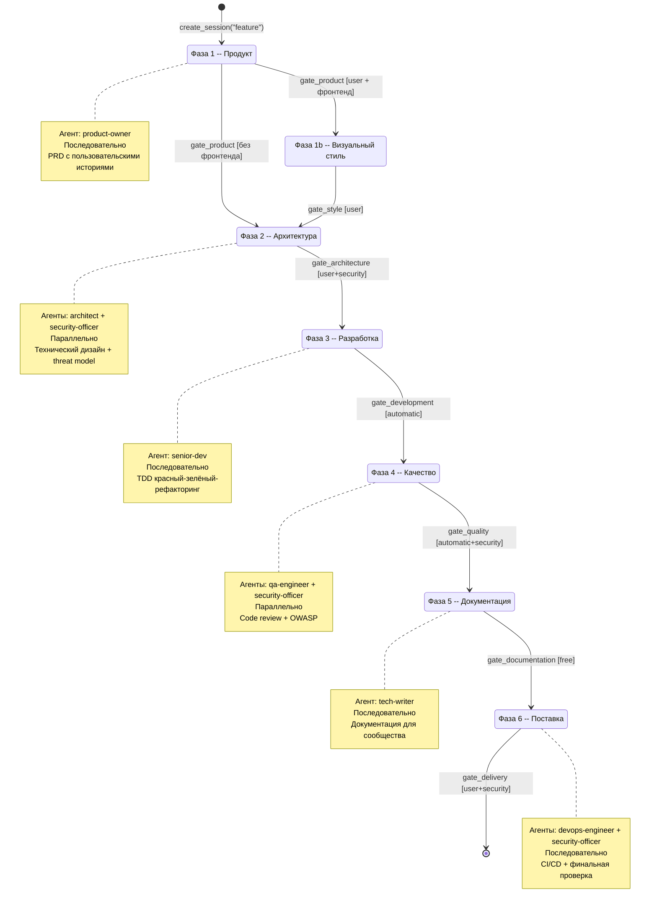
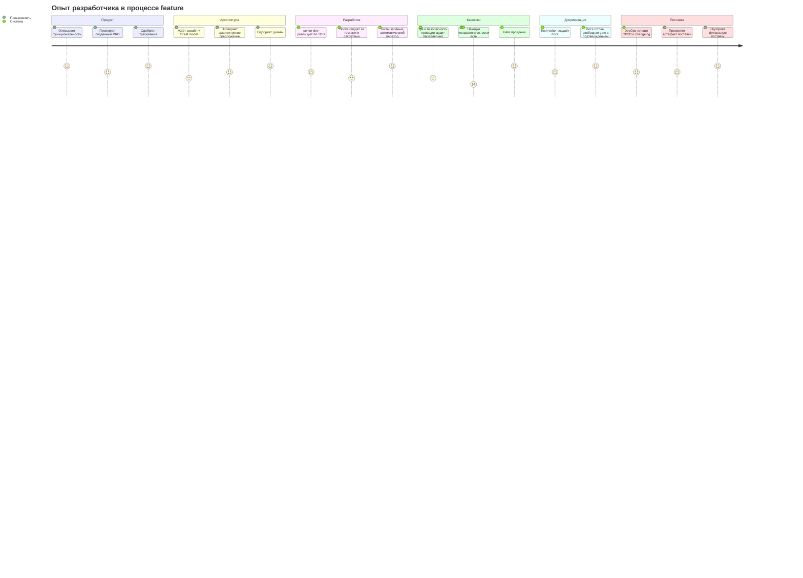
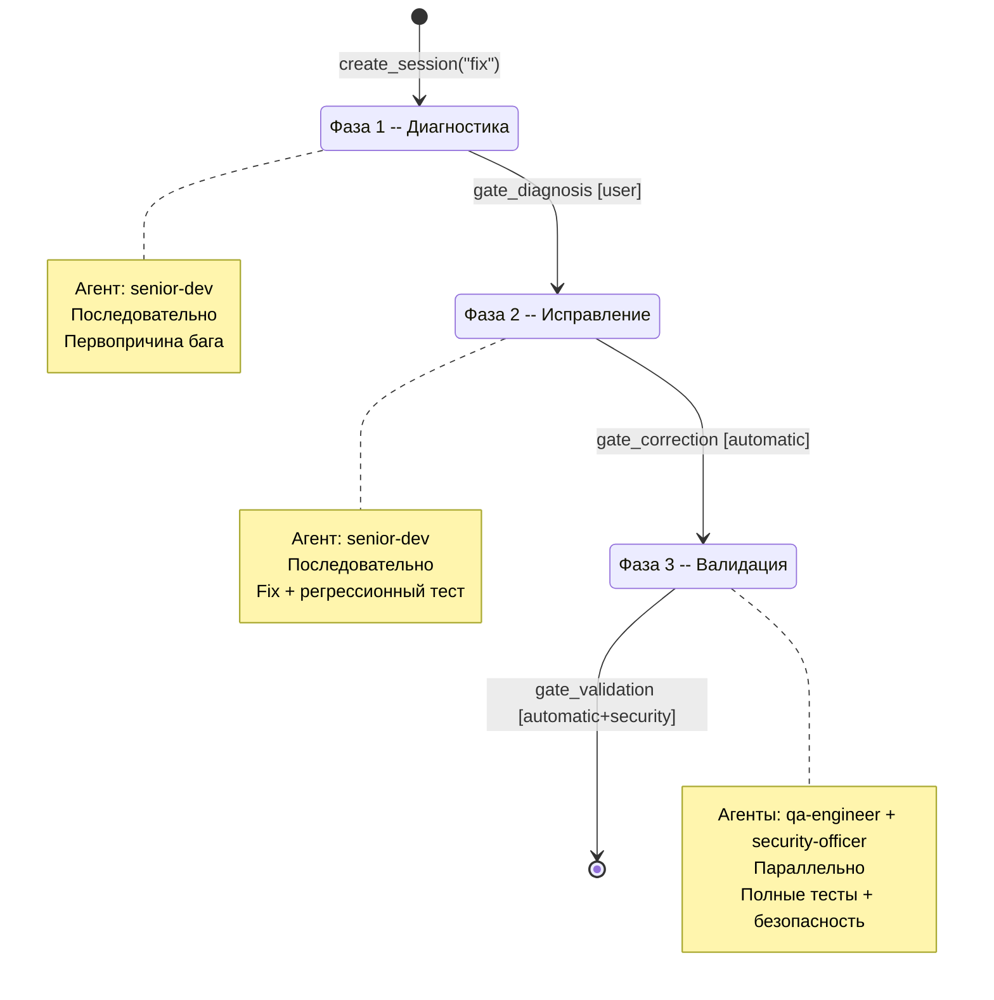
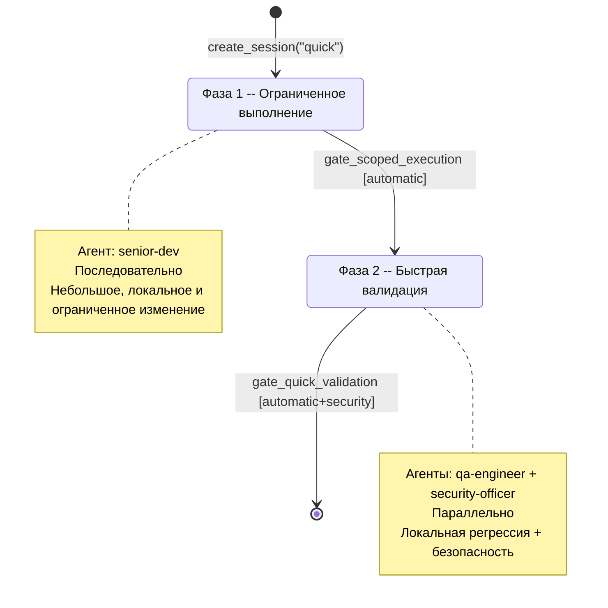
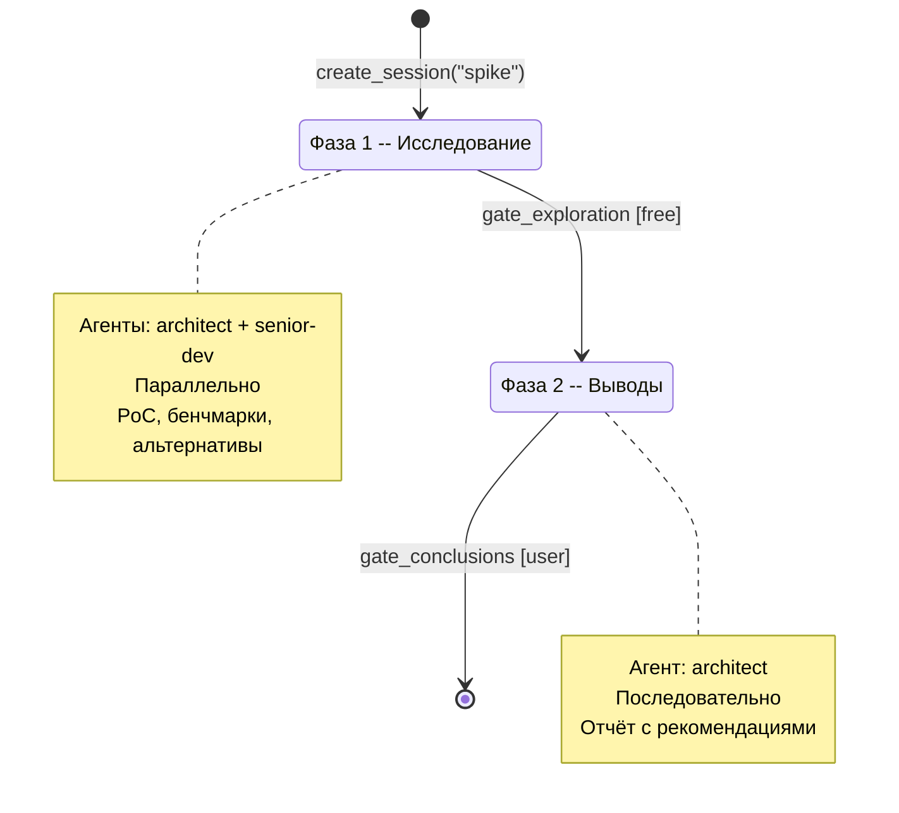
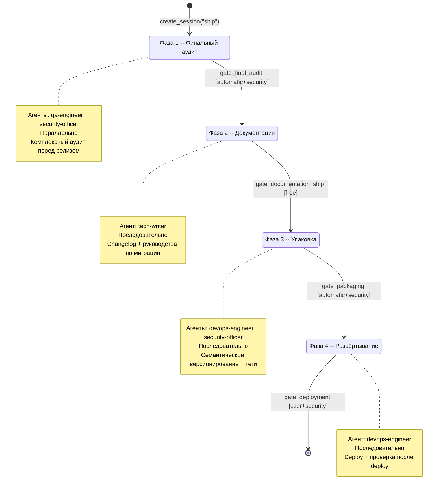
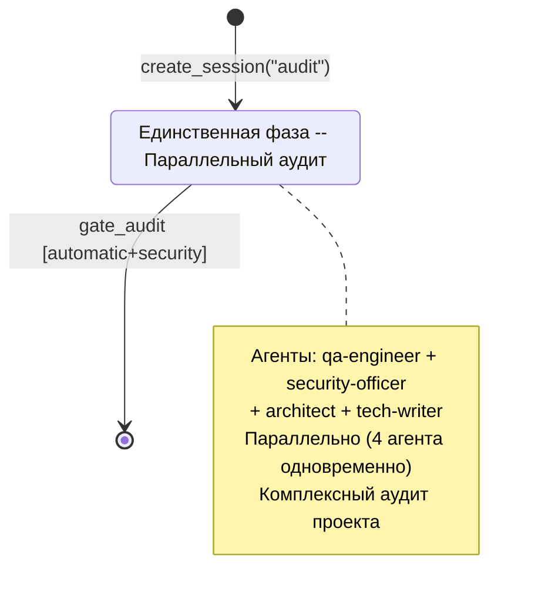

# Процессы

Alfred Dev делит разработку на 6 готовых процессов выполнения. Каждый процесс состоит из последовательных фаз, между которыми стоят quality gates. Такая структура нужна, потому что разработка ПО не монолитный процесс: новая функциональность требует анализа требований, проектирования, реализации, проверки качества, документации и поставки, а hotfix или небольшое изменение требуют более коротких маршрутов, соразмерных риску. Один и тот же процесс для всех сценариев был бы так же неэффективен, как полное отсутствие процесса.

Каждый процесс отвечает реальному сценарию жизненного цикла ПО:

| Процесс | Сценарий | Фазы |
|-------|-----------|-------|
| `feature` | Новая функциональность, от идеи до поставки | 7 (6 базовых + условный визуальный стиль) |
| `fix` | Исправление бага, от диагностики до валидации | 3 |
| `spike` | Исследование с формальными выводами | 2 |
| `ship` | Полный релиз: аудит, упаковка и развёртывание | 4 |
| `audit` | Комплексный аудит проекта за один шаг | 1 |
| `quick` | Небольшое изменение с меньшей церемонией, но с локальной регрессией и проверкой | 2 |

Кроме этих процессов выполнения, Alfred предоставляет операционные команды непрерывности (`map-codebase`, `discuss`, `next`, `pause`, `resume`, `progress`, `uat`). Они готовят, направляют или закрывают работу и не обязательно открывают мультиагентный процесс.

Процессы не произвольны: каждый точно задаёт, какие агенты участвуют, в каком порядке они выполняются и какие условия нужно выполнить, чтобы перейти от одной фазы к следующей. Эти условия и есть quality gates: контрольные точки, которые работают как барьеры между фазами и гарантируют, что работа соответствует стандартам, прежде чем идти дальше.

---

## 5 типов gate

Gates главный механизм контроля качества в оркестраторе. Без них фазы были бы просто списком задач без гарантии, что результат одной фазы валиден до начала следующей. Тип gate для каждой фазы выбран не случайно: он отражает уровень риска и характер проверки, которая нужна для этого конкретного перехода.

Оркестратор задаёт 5 типов gate как константы в `orchestrator.py`:

```python
GATE_FREE = "free"
GATE_USER = "user"
GATE_AUTOMATIC = "automatic"
GATE_USER_SECURITY = "user+security"
GATE_AUTOMATIC_SECURITY = "automatic+security"
```

### Gate `free`

Проходится, когда результат ответственного агента положительный и есть прямое подтверждение ожидаемого артефакта или чек-листа. Не требует зелёных тестов, аудита безопасности или одобрения человека. Но это не делает её безусловным одобрением: если не хватает docs, выводов, changelog или любого результата, который обещает фаза, gate должна остаться в ожидании или быть отклонена. Этот тип gate существует, потому что в некоторых фазах технические проверки не имеют смысла: например, фаза документации создаёт текст и диаграммы, а не исполняемый код. Требовать зелёные тесты от Markdown-файла было бы абсурдно. Свободная gate даёт процессу гибкость быстро проходить фазы с неисполняемыми артефактами и не ослабляет строгость в фазах, где она нужна.

### Gate `user`

Для прохождения нужно явное одобрение пользователя. Используется в фазах, где критерий приёмки субъективен и не автоматизируется: принять PRD, одобрить архитектурный дизайн или согласовать выводы исследования. Эти решения зависят от контекста проекта и приоритетов команды. Никакой автоматический тест не заменит это суждение.

### Gate `automatic`

Требует положительного результата и успешно пройденных тестов. Используется в фазах разработки, где критерии приёмки объективны и измеримы: код компилируется, тесты проходят, линтер не сообщает об ошибках. Преимущество этого типа gate в том, что он не требует участия человека: если метрики зелёные, процесс идёт дальше. Так фазы реализации идут плавнее без потери проверки.

### Gate `user+security`

Требует явного одобрения пользователя и положительного аудита безопасности. Используется в фазах поставки, где есть риск развёртывания: перед merge или публикацией релиза кто-то должен подтвердить, что результат соответствует ожиданиям и открытых уязвимостей нет. Сочетание человеческого суждения и проверки безопасности нужно, потому что развёртывание с известной уязвимостью может иметь необратимые последствия.

### Gate `automatic+security`

Требует зелёных тестов, положительного аудита безопасности и положительного результата. Это самый строгий тип gate в системе. Он используется в фазах качества и аудита, где допустимая ошибка должна быть минимальной. Например, фаза качества процесса feature сочетает code review (qa-engineer) с анализом OWASP (security-officer): обе проверки должны пройти, чтобы код перешёл к документации. Мало того, что тесты проходят, если осталась SQL-инъекция, и мало чистой безопасности, если тесты падают.

### Сравнительная сводка

Таблица ниже показывает, какие условия требует каждый тип gate. Это удобная быстрая справка при чтении описаний процессов:

| Тип gate | Положительный результат | Зелёные тесты | Безопасность OK | Одобрение пользователя |
|--------------|:-------------------:|:------------:|:------------:|:----------------------:|
| `free` | Да | -- | -- | -- |
| `user` | Да | -- | -- | Да |
| `automatic` | Да | Да | -- | -- |
| `user+security` | Да | -- | Да | Да |
| `automatic+security` | Да | Да | Да | -- |

---

## Формат вердикта

Все агенты используют стандартный формат вердикта, когда оценивают gate. Единый формат важен, потому что оркестратор обрабатывает результаты механически и не интерпретирует свободный текст. Кроме того, пользователь и hooks читают вердикт любого агента по одной логике.

Возможны три результата:

| Вердикт | Значение | Влияние на gate |
|-----------|-------------|----------------------|
| **ОДОБРЕНО** | Работа соответствует всем критериям gate. | Gate пройдена, процесс может перейти к следующей фазе. |
| **ОДОБРЕНО С УСЛОВИЯМИ** | Работа соответствует минимальным критериям, но есть замечания, которые стоит учесть. | Gate пройдена, но замечания фиксируются как технический долг или отложенные улучшения. |
| **ОТКЛОНЕНО** | Работа не соответствует требуемым критериям. | Gate блокирует продвижение. Нужно исправить указанные проблемы и оценить заново. |

Различие между ОДОБРЕНО и ОДОБРЕНО С УСЛОВИЯМИ сделано намеренно: процесс не останавливается из-за мелких замечаний (неудачное имя переменной, комментарий, который можно сделать понятнее), но формально фиксирует, что есть что пересмотреть. Это убирает эффект «всё или ничего», который раздражает разработчиков, когда ревью блокирует работу из-за косметики.

---

## Процесс feature

Процесс feature самый полный в системе: 6 базовых фаз плюс условная фаза 1b визуального стиля, до 8 агентов и 5 разных типов gate. Он покрывает полный жизненный цикл новой функциональности, от определения требований до финальной поставки. Каждая фаза даёт свой тип проверки, а агенты выбираются по специализации, а не по очереди.

### Фаза 1: продукт

Первая фаза существует потому, что писать код без понимания решаемой проблемы самый дорогой способ потерять время. Агент `product-owner` анализирует запрос пользователя, определяет функциональные и нефункциональные требования и создаёт PRD (Product Requirements Document) с пользовательскими историями.

Gate имеет тип `user`, потому что только пользователь может решить, отражает ли PRD то, что ему действительно нужно. Никакой автоматический тест не проверит, что требования верные.

| Свойство | Значение |
|-----------|-------|
| Агенты | `product-owner` |
| Выполнение | Последовательное |
| Gate | `gate_product` |
| Тип gate | `user` |
| Артефакт | PRD с пользовательскими историями |

### Фаза 1b: визуальный стиль (условная)

Если у проекта есть пользовательский интерфейс, Alfred включает `designer` между продуктом и архитектурой. Её задача не украшать в конце, а зафиксировать визуальное направление до того, как кто-то спроектирует компоненты или напишет CSS. Designer представляет три предложения, пользователь выбирает одно, и решение сохраняется в `docs/style-direction.md`, чтобы architect, senior-dev и опциональные фронтенд-агенты работали по одному ориентиру.

Gate остаётся типа `user`: нет валидного автоматического критерия, чтобы решить, какое визуальное направление лучше представляет продукт. Если у проекта нет фронтенда, фаза пропускается и не блокирует процесс.

| Свойство | Значение |
|-----------|-------|
| Агенты | `designer` |
| Выполнение | Последовательное |
| Gate | `gate_style` |
| Тип gate | `user` |
| Артефакт | Направление визуального стиля |

### Фаза 2: архитектура

Когда требования одобрены, нужно решить, как их реализовать. В этой фазе параллельно работают два агента: `architect` проектирует техническую архитектуру (паттерны, компоненты, интерфейсы), а `security-officer` готовит threat model (поверхность атаки, векторы, меры защиты). Они работают параллельно, потому что их задачи независимы: architect не нужен threat model для проектирования архитектуры, а security-officer не нужно архитектурное предложение для выявления угроз. В конце оба артефакта представляются пользователю вместе.

Gate имеет тип `user+security`, потому что архитектура это стратегическое решение, которое влияет на весь проект. Кроме того, продвинуться нельзя, если threat model или проверка `security-officer` нашли нерешённые риски. Пользователь должен понять и принять дизайн, а безопасность должна его проверить до того, как будет написана хоть одна строка кода.

| Свойство | Значение |
|-----------|-------|
| Агенты | `architect`, `security-officer` |
| Выполнение | Параллельное |
| Gate | `gate_architecture` |
| Тип gate | `user+security` |
| Артефакты | Архитектурное предложение, threat model |

### Фаза 3: разработка

Когда требования одобрены и архитектура проверена, агент `senior-dev` реализует код по строгому TDD: сначала пишет падающие тесты (красный), затем минимальный код, чтобы они прошли (зелёный), и в конце рефакторит, чтобы улучшить качество без изменения поведения (рефакторинг). Этот цикл не обещает построчного покрытия: он требует поведенческих тестов для критериев приёмки и оставляет исполняемое подтверждение до перехода дальше.

Gate имеет тип `automatic`, потому что в этой фазе критерии приёмки объективны: код компилируется и тесты проходят. Одобрение человека не нужно, чтобы проверить, что `2 + 2 == 4`. Так разработчик быстро итерирует и не ждёт внешних проверок.

| Свойство | Значение |
|-----------|-------|
| Агенты | `senior-dev` |
| Выполнение | Последовательное |
| Gate | `gate_development` |
| Тип gate | `automatic` |
| Артефакт | Код с тестами |

### Фаза 4: качество

Фаза качества самый строгий барьер процесса. Два агента работают параллельно: `qa-engineer` выполняет code review, план тестов и анализ покрытия, а `security-officer` проводит аудиты OWASP, проверяет зависимости и создаёт SBOM. Параллельность оправдана, потому что оба аудита независимы и вместе покрывают два критических измерения качества: функциональное (работает ли правильно?) и нефункциональное (безопасно ли?).

Gate имеет тип `automatic+security`, самый строгий в системе. Для продвижения одновременно нужны три вещи: зелёные тесты, положительный аудит безопасности и положительный результат code review. Если хотя бы одно не выполнено, gate блокирует продвижение, и нужно исправить проблему, прежде чем продолжить.

CTO включён по умолчанию. Если `cto` активен в `session_team`, он входит после них как внешняя последовательная проверка готовой фичи через Greptile CLI. Greptile видит только закоммиченные изменения ветки. Отчёт CTO не заменяет вердикт QA и безопасности.

| Свойство | Значение |
|-----------|-------|
| Агенты | `qa-engineer`, `security-officer` |
| Выполнение | Параллельное |
| Gate | `gate_quality` |
| Тип gate | `automatic+security` |
| Артефакты | Отчёт QA, отчёт по безопасности |

### Фаза 5: документация

Агент `tech-writer` создаёт техническую и пользовательскую документацию для сообщества: документацию API, руководства по использованию, архитектурные диаграммы и любые другие артефакты, чтобы другие разработчики поняли функциональность без чтения исходного кода.

Gate имеет тип `free`, потому что документация это текст, а не исполняемый код. Требовать зелёные тесты от Markdown-файла бессмысленно. Чтобы перейти к последней фазе, достаточно положительного результата (tech-writer создал документацию).

| Свойство | Значение |
|-----------|-------|
| Агенты | `tech-writer` |
| Выполнение | Последовательное |
| Gate | `gate_documentation` |
| Тип gate | `free` |
| Артефакт | Техническая и пользовательская документация |

### Фаза 6: поставка

Финальная фаза готовит результат к поставке: `devops-engineer` отвечает за CI/CD, changelog и подготовку merge, а `security-officer` проводит финальную проверку, чтобы убедиться, что после фазы качества ничего не изменилось в ущерб безопасности.

Gate имеет тип `user+security`, потому что неверный merge или deploy может затронуть всю команду. Нужны и явное одобрение пользователя (он подтверждает, что хочет поставку), и согласие безопасности (она подтверждает, что открытых уязвимостей нет). Это последняя линия защиты до того, как код попадёт в production.

| Свойство | Значение |
|-----------|-------|
| Агенты | `devops-engineer`, `security-officer` |
| Выполнение | Последовательное |
| Gate | `gate_delivery` |
| Тип gate | `user+security` |
| Артефакты | Changelog, артефакт поставки |

### Диаграмма состояний процесса feature

Диаграмма ниже показывает 6 базовых фаз и условную фазу 1b как состояния, а gates как переходы между ними. Заметки указывают, какие агенты участвуют в каждой фазе и как они выполняются.



### Опыт пользователя в процессе feature

Эта диаграмма пути показывает, как пользователь воспринимает разные фазы процесса, что он делает в каждой и какой уровень удовлетворённости ожидать. Начальные фазы требуют больше активного участия (проверить PRD, одобрить архитектуру), средние более автономны (senior-dev реализует, QA проверяет), а финальная снова требует внимания, чтобы одобрить поставку.



---

## Процесс fix

Процесс fix короче процесса feature, потому что у бага уже есть контекст: существующий код работает не так, как должен. Анализ требований и архитектурный дизайн не нужны. Нужно найти первопричину, исправить её и проверить, что исправление ничего не ломает.

### Фаза 1: диагностика

Агент `senior-dev` ищет первопричину бага: воспроизводит проблему, анализирует логи и трассировки, определяет затронутый компонент и документирует находки. Gate имеет тип `user`, потому что диагностика может показать, что проблема глубже, чем ожидалось (например, дефект дизайна), и пользователь должен решить, делать точечный fix или пересмотреть решение.

| Свойство | Значение |
|-----------|-------|
| Агенты | `senior-dev` |
| Выполнение | Последовательное |
| Gate | `gate_diagnosis` |
| Тип gate | `user` |
| Артефакт | Отчёт о первопричине |

### Фаза 2: исправление

Когда диагностика одобрена, `senior-dev` реализует исправление вместе с регрессионным тестом, который доказывает, что баг устранён. Регрессионный тест обязателен: без него нельзя автоматически проверить, что баг не вернётся в будущем. Gate имеет тип `automatic`, потому что критерий приёмки объективен: регрессионный тест проходит, а существующие тесты остаются зелёными.

| Свойство | Значение |
|-----------|-------|
| Агенты | `senior-dev` |
| Выполнение | Последовательное |
| Gate | `gate_correction` |
| Тип gate | `automatic` |
| Артефакт | Fix с регрессионным тестом |

### Фаза 3: валидация

Финальная фаза запускает полный набор тестов и проверку безопасности, чтобы убедиться, что исправление не дало побочных эффектов. `qa-engineer` и `security-officer` работают параллельно, потому что их проверки независимы. Gate имеет тип `automatic+security`, самый строгий, потому что плохо проверенный fix может навредить больше, чем исходный баг.

| Свойство | Значение |
|-----------|-------|
| Агенты | `qa-engineer`, `security-officer` |
| Выполнение | Параллельное |
| Gate | `gate_validation` |
| Тип gate | `automatic+security` |
| Артефакт | Отчёт о полной валидации |

### Диаграмма состояний процесса fix



---

## Процесс quick

Процесс quick нужен для небольших локальных изменений с ограниченным риском, где полный `feature` был бы несоразмерен. Его цель сохранить техническую дисциплину (постоянное состояние, тесты, безопасность и последующий verify) без церемонии discovery, формальной архитектуры или объёмной документации, когда они не дают пользы.

Перед первой фазой Alfred готовит сессию через helper непрерывности и определяет реальный `session_team`. Эта команда может прийти из временной динамической композиции или, если её нет, из сохранённого fallback в `.claude/alfred-dev.local.md`. В обоих случаях `session_team` каноничный runtime-источник. Единственный опциональный агент CTO. В фазы `quick` он не входит и остаётся по запросу, и это отражается в `current.md`, `progress.md` и `traceability.md`.

### Фаза 1: ограниченное выполнение

`senior-dev` ведёт реализацию изменения. Фаза не добавляет специалистов 0.6: единственный опциональный агент runtime это CTO, и в `quick` он не участвует. Gate имеет тип `automatic`, потому что критерий остаётся объективным: локальное изменение, зелёные проверки и без блокировки непрерывности.

| Свойство | Значение |
|-----------|-------|
| Агенты | `senior-dev` |
| Выполнение | Последовательное |
| Gate | `gate_scoped_execution` |
| Тип gate | `automatic` |
| Артефакт | Ограниченное изменение с локальными проверками |

### Фаза 2: быстрая валидация

Вторая фаза проверяет, что небольшое изменение остаётся безопасным и не даёт регрессии в затронутой области. `qa-engineer` и `security-officer` работают параллельно. CTO здесь не подключается: он проверяет только полностью готовую фичу. Внешнее ревью можно запустить отдельно через `/alfred-dev:cto`.

| Свойство | Значение |
|-----------|-------|
| Агенты | `qa-engineer`, `security-officer` |
| Выполнение | Параллельное |
| Gate | `gate_quick_validation` |
| Тип gate | `automatic+security` |
| Артефакт | Быстрая проверка регрессии и безопасности |

### Диаграмма состояний процесса quick



---

## PR-цикл после feature, fix и quick

Если у проекта есть remote на GitHub, после последней фазы `feature`, `fix` или `quick` Alfred открывает PR и ведёт его до мержа. Это не отдельная фаза с gate в состоянии сессии, а общий протокол `commands/_pr_loop.md`. Тот же цикл запускает `/alfred-dev:pr`.

Каждый раунд helper `pr-status` возвращает вердикт, и Alfred действует только по нему:

| Вердикт | Действие |
|---|---|
| `wait` | Ждёт checks и ревью, при запросе helper запускает ревью Greptile |
| `fix` | `senior-dev` исправляет замечания, checks, issues SonarCloud и покрытие |
| `conflict` | `senior-dev` вливает базовую ветку и разрешает конфликты, без rebase и force push |
| `merge` | Alfred мержит сам, без подтверждения |
| `needs_user` | Цикл останавливается и спрашивает пользователя |
| `done` | PR уже смержен или закрыт |

Условия мержа: все треды закрыты, checks зелёные, Greptile 5/5 или 4/5 с названной причиной, SonarCloud без issues и со 100% покрытия нового кода, нет конфликтов. Одобрение человека не нужно, но его замечания должны быть закрыты. Предел: 5 раундов исправлений.

---

## Процесс spike

Процесс spike нужен для исследований, где цель не production-код, а ответ на технический вопрос: подходит ли эта технология для нашего сценария? Какие есть альтернативы? Какой ожидаемый уровень производительности? Структура намеренно лёгкая (2 фазы), потому что исследование с лишней бюрократией перестаёт быть исследованием.

Если `session_team` приходит с активными опциональными агентами из динамической
композиции или из fallback в `.claude/alfred-dev.local.md`, он остаётся каноничным
runtime-источником. В `spike` опциональные агенты по умолчанию не входят в
стандартный цикл и считаются специалистами **по запросу**: они подключаются,
только если тема исследования явно этого требует.

### Фаза 1: исследование

`architect` и `senior-dev` работают параллельно и покрывают два взаимодополняющих угла: architect оценивает альтернативы на уровне дизайна (паттерны, интеграции, компромиссы), а senior-dev строит прототипы и запускает бенчмарки. Параллельность оправдана, потому что обе точки зрения независимы и вместе дают более полную картину.

Gate имеет тип `free`, потому что исследование по определению открыто: нет тестов, которые нужно пройти, и нет production-кода для аудита. Для продвижения достаточно, чтобы агенты выдали результаты. Это сделано намеренно: строгие gates в исследовании убили бы креативность и скорость, которых ждут от spike.

| Свойство | Значение |
|-----------|-------|
| Агенты | `architect`, `senior-dev` |
| Выполнение | Параллельное |
| Gate | `gate_exploration` |
| Тип gate | `free` |
| Артефакты | PoC, бенчмарки, анализ альтернатив |

### Фаза 2: выводы

Агент `architect` сводит все находки исследования в формальный отчёт с практическими рекомендациями. Отчёт отвечает на исходный вопрос spike данными, а не мнениями. Gate имеет тип `user`, потому что выводы исследования влияют на стратегические решения проекта, и пользователь должен оценить их, прежде чем действовать.

| Свойство | Значение |
|-----------|-------|
| Агенты | `architect` |
| Выполнение | Последовательное |
| Gate | `gate_conclusions` |
| Тип gate | `user` |
| Артефакт | Отчёт с рекомендациями |

### Диаграмма состояний процесса spike



---

## Процесс ship

Процесс ship покрывает полный процесс релиза: от предварительного аудита до развёртывания в production. В этом процессе больше всего проверок безопасности, потому что каждая фаза работает с артефактами, которые попадут к конечным пользователям. Ошибку здесь не исправить быстрым hotfix: может понадобиться rollback, сообщение об инциденте или новый релиз.

### Фаза 1: финальный аудит

Прежде чем что-то упаковывать, `qa-engineer` и `security-officer` параллельно проверяют текущее состояние проекта. Эта фаза нужна, потому что код мог пройти gates процесса feature по отдельности, но целое (несколько накопленных features, fixes и рефакторингов) требует комплексной проверки. Gate имеет тип `automatic+security`, потому что критерии объективны и перед релизом не допускают исключений.

Если `cto` активен в `session_team` (по умолчанию да), он входит после них как внешний
последовательный аудитор через Greptile CLI, чтобы перепроверить это закрытие до перехода к упаковке.

| Свойство | Значение |
|-----------|-------|
| Агенты | `qa-engineer`, `security-officer` |
| Выполнение | Параллельное |
| Gate | `gate_final_audit` |
| Тип gate | `automatic+security` |
| Артефакт | Отчёт о комплексном аудите |

### Фаза 2: документация

Агент `tech-writer` пишет документацию релиза: changelog, руководства по миграции, примечания к версии и любые другие документы, которые нужны пользователям, чтобы перейти на новую версию. Gate имеет тип `free`, потому что проверять нужно не код, а только текст.

| Свойство | Значение |
|-----------|-------|
| Агенты | `tech-writer` |
| Выполнение | Последовательное |
| Gate | `gate_documentation_ship` |
| Тип gate | `free` |
| Артефакты | Changelog, примечания к версии, руководства по миграции |

### Фаза 3: упаковка

`devops-engineer` и `security-officer` создают версионированный и подписанный артефакт релиза. Участие security-officer в этой фазе гарантирует, что упакованный артефакт не содержит уязвимых зависимостей или утёкших секретов. Gate имеет тип `automatic+security`: упаковка должна создать проверяемый артефакт, а проверка безопасности и подписи должна быть положительной.

Удалённое зеркало при необходимости делает `/alfred-dev:sync-github` на основе локальной доски. Агента `github-manager` нет.

| Свойство | Значение |
|-----------|-------|
| Агенты | `devops-engineer`, `security-officer` |
| Выполнение | Последовательное |
| Gate | `gate_packaging` |
| Тип gate | `automatic+security` |
| Артефакт | Релиз с семантическим версионированием |

### Фаза 4: развёртывание

Агент `devops-engineer` выполняет развёртывание в production с проверкой после deploy и подготовленным rollback. Gate имеет тип `user+security`, потому что развёртывание это точка невозврата: после публикации пользователи могут скачать релиз. Нужно явное одобрение пользователя (он подтверждает, что хочет развернуть) и безопасность OK (она подтверждает, что всё чисто). Даже в режиме autopilot это подтверждение человека сохраняется: процесс может автоматизировать всю подготовку, но не финальный акт публикации.

`sync-github` может выровнять удалённую доску после развёртывания, но никогда не заменяет подтверждение человека.

| Свойство | Значение |
|-----------|-------|
| Агенты | `devops-engineer` |
| Выполнение | Последовательное |
| Gate | `gate_deployment` |
| Тип gate | `user+security` |
| Артефакт | Развёрнутый релиз |

### Диаграмма состояний процесса ship



---

## Процесс audit

Процесс audit единственный с одной фазой, и это осознанное решение дизайна. Его цель провести комплексный аудит проекта как можно быстрее, без церемонии многофазного процесса. Он используется двумя способами: как самостоятельный процесс (когда пользователь хочет быстро проверить состояние проекта) и как обязательный шаг при закрытии спринта.

### Фаза 1: параллельный аудит

Четыре агента работают одновременно, каждый в своей области специализации:

- `qa-engineer` запускает набор тестов, проверяет покрытие и анализирует технический долг.
- `security-officer` проверяет зависимости, ищет уязвимости и проверяет, что нет раскрытых секретов.
- `architect` проверяет согласованность архитектуры, находит нарушения паттернов и оценивает долг дизайна.
- `tech-writer` проверяет полноту и согласованность существующей документации.

Полная параллельность оправдана, потому что четыре агента работают над полностью независимыми аспектами проекта. Нет зависимости между проверкой покрытия тестами и аудитом зависимостей, или между согласованностью архитектуры и документацией. Последовательный запуск увеличил бы время в четыре раза без всякой пользы.

CTO в `audit` не участвует: он проверяет только полностью готовую фичу в `feature`
и `ship`. Внешнее ревью закоммиченных изменений ветки можно запустить отдельно
через `/alfred-dev:cto`.

Если `session_team` приходит с активными опциональными агентами из динамической
композиции или из fallback в `.claude/alfred-dev.local.md`, он остаётся каноничным
runtime-источником. В `audit` опциональные агенты, включая `cto`, не входят
в стандартный цикл и считаются специалистами **по запросу**.

Gate имеет тип `automatic+security`, потому что аудит, который можно пройти с посредственными результатами, не имеет смысла. Если любой из четырёх агентов находит критическую проблему, gate блокирует, и проблему нужно решить.

| Свойство | Значение |
|-----------|-------|
| Агенты | `qa-engineer`, `security-officer`, `architect`, `tech-writer` |
| Выполнение | Параллельное |
| Gate | `gate_audit` |
| Тип gate | `automatic+security` |
| Артефакты | Отчёты о качестве, безопасности, архитектуре и документации |

### Диаграмма состояний процесса audit



---

## Паттерн параллельности

Не все фазы запускают агентов параллельно, и решение, когда использовать параллельность, не произвольно. Критерий простой: агенты запускаются параллельно, когда работают независимо и их результаты не зависят друг от друга. Они запускаются последовательно, когда между ними есть зависимость.

### Фазы с параллельным выполнением

| Процесс | Фаза | Агенты параллельно | Причина параллельности |
|-------|------|---------------------|-----------------------|
| `feature` | architecture | `architect`, `security-officer` | Технический дизайн и threat model независимы. Architect не нужен threat model для проектирования, а security-officer не нужна архитектура для выявления угроз. |
| `feature` | quality | `qa-engineer`, `security-officer` | Функциональный code review и аудит безопасности покрывают разные измерения одного кода. Зависимости между ними нет. |
| `fix` | validation | `qa-engineer`, `security-officer` | Набор тестов и проверка безопасности независимы. Параллельный запуск сокращает время валидации вдвое. |
| `spike` | exploration | `architect`, `senior-dev` | Architect оценивает альтернативы дизайна, пока senior-dev строит PoC. Оба подхода дополняют друг друга и не зависят друг от друга. |
| `ship` | final_audit | `qa-engineer`, `security-officer` | Функциональный аудит и аудит безопасности, независимые, как в фазе качества процесса feature. |
| `audit` | parallel_audit | `qa-engineer`, `security-officer`, `architect`, `tech-writer` | Четыре измерения (качество, безопасность, архитектура, документация) полностью независимы. Максимально возможная параллельность. |

### Фазы без параллельности

Остальные фазы выполняются последовательно по одной из двух причин:

1. **Один агент**: когда агент только один (например, `senior-dev` в фазе разработки или `tech-writer` в документации), параллельность неприменима.
2. **Неявная зависимость**: в фазе поставки процесса feature `devops-engineer` и `security-officer` участвуют вместе, но не параллельно, потому что security-officer должен проверить артефакт, который создаёт devops-engineer, а не независимый аспект проекта.

---

## Состояние сессии

Всё состояние текущего процесса хранится в одном JSON-файле: `.claude/alfred-dev-state.json`. Этот файл ось координации всей системы: commands читают его, чтобы знать, в какой мы фазе и каких агентов вызывать, hooks читают его, чтобы решить, блокировать действие или пропустить, а оркестратор пишет его атомарно (запись во временный файл + переименование через `os.replace`), чтобы файл не повредился, если процесс прервётся.

Плоский JSON-файл вместо базы данных SQLite выбран намеренно: состояние сессии временное (живёт, пока идёт процесс), а его структура плоская (связей между сущностями нет). База данных зарезервирована для исторической памяти проекта, где связи есть и нужны сложные запросы.

### Структура JSON

```json
{
  "command": "feature",
  "description": "Реализовать систему push-уведомлений",
  "current_phase": "development",
  "phase_number": 2,
  "completed_phases": [
    {
      "name": "product",
      "result": "approved",
      "artifacts": ["prd-notifications.md"],
      "completed_at": "2026-02-21T10:15:30+00:00"
    },
    {
      "name": "architecture",
      "result": "approved",
      "artifacts": ["notifications-design.md", "threat-model.md"],
      "completed_at": "2026-02-21T11:42:18+00:00"
    }
  ],
  "artifacts": [
    "prd-notifications.md",
    "notifications-design.md",
    "threat-model.md"
  ],
  "created_at": "2026-02-21T09:30:00+00:00",
  "updated_at": "2026-02-21T11:42:18+00:00"
}
```

### Описание полей

| Поле | Тип | Описание |
|-------|------|-------------|
| `command` | `string` | Идентификатор активного процесса (`feature`, `fix`, `spike`, `ship`, `audit`). |
| `description` | `string` | Описание задачи на естественном языке, в том виде, в каком его дал пользователь. |
| `current_phase` | `string` | Имя текущей фазы или `"completed"`, если процесс завершён. |
| `phase_number` | `int` | Индекс текущей фазы (с 0). Позволяет оркестратору напрямую обратиться к описанию фазы в массиве `FLOWS[command]["phases"]`. |
| `completed_phases` | `array` | История пройденных фаз: для каждой имя, результат, созданные артефакты и отметка времени завершения. |
| `artifacts` | `array` | Накопленный список всех артефактов, созданных за процесс. Это объединение артефактов каждой завершённой фазы. |
| `created_at` | `string` | Отметка времени ISO 8601 момента создания сессии. |
| `updated_at` | `string` | Отметка времени ISO 8601 последнего изменения состояния. Обновляется каждый раз, когда оркестратор переходит к следующей фазе. |

### Как hooks читают этот файл

Hooks обращаются к файлу состояния, чтобы принимать решения с учётом контекста. Например, hook `quality-gate.py` должен знать, идёт ли фаза разработки (где красные тесты носят информационный характер) или фаза качества (где красные тесты блокируют продвижение). Hook `activity-capture.py` должен знать фазу и процесс, чтобы связать захваченные события с правильной итерацией в постоянной памяти.

Схема чтения всегда одна: hook читает JSON-файл, извлекает нужные поля (`command`, `current_phase`, `phase_number`) и подстраивает поведение под контекст. Если файла нет (потому что активного процесса нет), hook работает в режиме по умолчанию и ничего не блокирует.
    note right of visual_style
        Агент: designer
        Последовательно
        Три предложения + визуальный выбор
    end note
