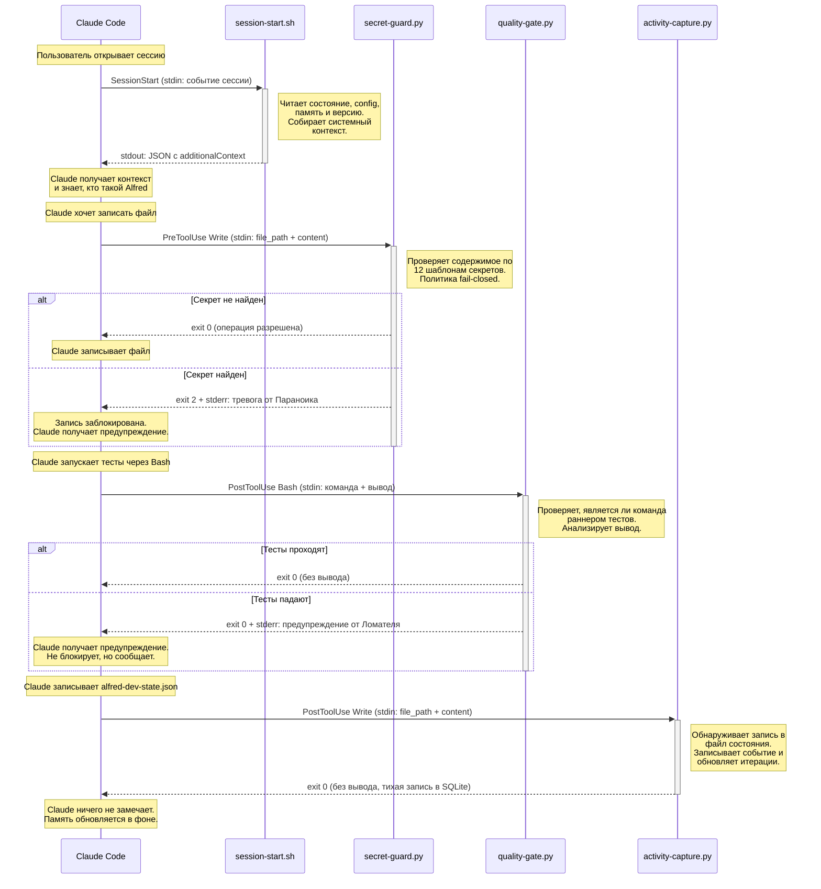

# Система хуков

Хуки связывают Alfred Dev с жизненным циклом Claude Code. Claude Code генерирует события в ключевые моменты сессии --при запуске, перед использованием инструмента, после него, при попытке остановиться-- и позволяет плагинам регистрировать скрипты, которые выполняются в ответ на эти события. По сути это система типизированных наблюдателей: каждый хук подписан на конкретный тип события с необязательным фильтром (matcher), который ограничивает, на какие инструменты он действует, а Claude Code вызывает его в нужный момент.

В Alfred Dev хуки внедряют контекст при запуске, блокируют секреты и опасные команды, следят за тестами и доказательствами, сохраняют полезную память и закрывают Memory UI при выходе. Stop-хука Ralph и хуков орфографии или зависимостей нет.

---

## Как работают хуки в Claude Code

Механизм хуков в Claude Code следует простой модели: регистрация, вызов и ответ. Эту модель нужно понимать, чтобы понять, почему каждый хук Alfred устроен именно так.

### Регистрация

Хуки объявляются в файле `hooks/hooks.json` репозитория. Каждая запись связывает событие жизненного цикла с одним или несколькими скриптами. Базовая структура:

```json
{
  "hooks": {
    "EventName": [
      {
        "matcher": "tool_filter_regex",
        "hooks": [
          {
            "type": "command",
            "command": "path/to/script.sh",
            "timeout": 10,
            "async": false
          }
        ]
      }
    ]
  }
}
```

Поле `matcher` используй только в событиях, где Claude Code его поддерживает. В Alfred оно фильтрует имя инструмента (`PreToolUse` и `PostToolUse`) или тип сессии (`SessionStart`). Если matcher не указан, хук выполняется при каждом вызове этого события. Это важно: хук `PostToolUse` без matcher выполнялся бы после каждой операции любого инструмента, а это лишняя нагрузка на производительность. В событиях `UserPromptSubmit`, `Stop`, `PostToolBatch`, `TaskCreated`, `TaskCompleted`, `WorktreeCreate`, `WorktreeRemove`, `CwdChanged`, `MessageDisplay` и `TeammateIdle` Claude Code игнорирует `matcher`; `release:audit` падает, если Alfred объявляет там matcher, чтобы не создавать ложного ощущения фильтрации. Этот плагин не регистрирует `Stop`, `UserPromptExpansion` и `PreCompact`. Если зарегистрировать `PreCompact`, matcher `manual\|auto` опускается, чтобы покрыть оба типа сжатия. Поле `if` вычисляется только в событиях инструментов (`PreToolUse`, `PostToolUse`, `PostToolUseFailure`, `PermissionRequest` и `PermissionDenied`); в любом другом событии его не используй, потому что handler не выполнится.

### Вызов

Когда Claude Code генерирует событие, совпадающее с зарегистрированным хуком, он запускает указанный скрипт как внешний процесс. Данные события передаются через **stdin** в формате JSON. Точное содержимое JSON зависит от типа события, но обычно включает:

- `tool_name`: имя инструмента, который вызвал событие (Write, Edit, Bash и т. д.).
- `tool_input`: параметры, которые Claude передал инструменту (путь к файлу, содержимое, команда...).
- `tool_output`: результат инструмента (есть только в `PostToolUse`).

### Ответ

Скрипт отвечает по трём каналам:

| Канал | Назначение |
|-------|-----------|
| **stdout** | Структурированный ответ (JSON). Claude Code интерпретирует его в зависимости от типа события. В `SessionStart` и `PreCompact` поле `hookSpecificOutput.additionalContext` внедряется как контекст разговора. JSON должен включать `hookSpecificOutput.hookEventName`. В `Stop` объект с `"decision": "block"` не даёт Claude остановиться. Если предупреждение для пользователя должно быть структурированным, JSON может включать `systemMessage`. |
| **stderr** | Короткие диагностические сообщения или предупреждения. Claude Code показывает их в зависимости от события; Alfred использует этот канал для информационных предупреждений quality-gate и чтения чувствительных файлов. |
| **Exit code** | `0` означает, что операция разрешена, `2` означает блокировку (имеет смысл только в `PreToolUse`). Любой другой ненулевой код считается ошибкой хука и игнорируется. |

### Режимы выполнения

Хуки бывают **синхронными** и **асинхронными**. В синхронном режиме (по умолчанию) Claude Code ждёт завершения скрипта, прежде чем продолжить. Это обязательно для хуков, которые должны блокировать операцию, например `secret-guard.py`. В асинхронном режиме (`"async": true`) Claude Code запускает скрипт и продолжает работу, не дожидаясь результата. Это подходит для хуков внедрения контекста, таких как `session-start.sh`.

У каждого хука есть **настраиваемый timeout** в секундах. Если скрипт не завершился за это время, Claude Code его убивает и продолжает так, будто хука нет. Этот механизм защищает от зависших скриптов, которые могли бы блокировать сессию бесконечно.

---

## Хуки Alfred Dev 0.7.0

Alfred Dev регистрирует десять видимых скриптов в `SessionStart`, `SessionEnd`, `UserPromptSubmit`, `PreToolUse` и `PostToolUse`. Stop-хука Ralph и хуков сжатия или орфографии нет. У каждого хука одна ответственность, и он безопасно обрабатывает сбои: exit 0, кроме блокировки секретов и опасных команд.

### session-bootstrap.sh

**Событие:** `SessionStart` -- **Matcher:** `startup|resume|clear|compact` -- **Timeout:** 10 с -- **Асинхронный:** нет

Этот лёгкий хук устраняет гонку при первом запуске в Claude Code CLI. Его задача чисто операционная: подготовить проект до того, как Claude обработает первый промпт. Он делает пять вещей, все идемпотентные и локальные для репозитория:

1. создаёт или исправляет `.claude/alfred-dev.local.md` с автономностью CLI-first и включённой памятью;
2. создаёт `.claude/alfred-memory.db`, если его ещё нет;
3. генерирует `.claude/settings.local.json` и `.claude/settings.json` с минимальным allowlist для команд helper-first;
4. создаёт локальный wrapper `.claude/alfred-continuity.py`;
5. обеспечивает активную итерацию `session` в SQLite проекта.

Wrapper лежит в проекте, чтобы Claude Code мог запускать helpers через
локальное и ограниченное правило Bash. При этом он не полагается только на
абсолютный путь к кешу: сначала использует `CLAUDE_PLUGIN_ROOT`, если он
доступен, затем встроенный fallback, а если эта установка уже заменена, ищет
активный кеш `alfred-dev`.

Хук не внедряет дополнительный контекст в Claude и не делает сетевых вызовов. Именно поэтому он синхронный: он должен завершиться до того, как первая slash-команда начнёт зависеть от этих артефактов.

### prompt-route.py

**Событие:** `UserPromptSubmit` -- **Matcher:** нет -- **Timeout:** 5 с -- **Асинхронный:** нет

Если пользователь пишет обычным текстом без slash, хук классифицирует запрос
(`fix`, `quick`, `resume`, `ship`…) и внедряет `additionalContext`, чтобы
Claude действовал как эта команда. Если `/alfred-dev:` уже есть или сигнала
нет, хук ничего не говорит. Fail-open.

### session-end.py

**Событие:** `SessionEnd` -- **Асинхронный:** да

Останавливает Memory UI и, если была сессия или доказательства тестов, пишет
`.claude/alfred-last-closing.md` с блоком для вставки. Работу не выдумывает.

### session-start.sh

**Событие:** `SessionStart` -- **Matcher:** `startup|resume|clear|compact` -- **Асинхронный:** да

Выполняется сразу после bootstrap. Внедряет протокол общения без slash и
briefing из трёх строк: сессия/handoff/UAT, последнее решение и принятые ADR.
Если helper падает, использует короткий fallback.

Briefing собирается в `core/session_brief.py` (состояние, handoff, UAT,
память и ADR). GitHub не вызывается. Quality gates, проверяемые по подтверждению,
остаются в процессах, а не в этом хуке.

На выходе JSON с ключом `hookSpecificOutput.additionalContext`, который Claude Code внедряет как системный контекст.

### secret-guard.py

**Событие:** `PreToolUse` -- **Matcher:** `Write|Edit|Bash|mcp__.*` -- **Timeout:** 5 с

Этот хук блокирует запись секретов. Он выполняется **до** Write, Edit, Bash или пишущего MCP tool, анализирует содержимое и, если находит шаблон секрета, запрещает операцию с exit code 2.

Политика этого хука **fail-closed**: если скрипт не может разобрать вход из stdin или загрузить канонический источник шаблонов (`core/secrets.py`), он блокирует операцию из осторожности. Это осознанное решение: ложное срабатывание, из-за которого нужно повторить попытку, лучше пропуска, который оставляет секрет открытым в репозитории.

Скрипт находит 12 семейств шаблонов секретов и общий шаблон присваивания учётных данных:

| Шаблон | Описание |
|--------|-------------|
| `AKIA[0-9A-Z]{16}` | AWS Access Key |
| `sk-[a-zA-Z0-9]{20,}` | API-ключ с префиксом sk- (OpenAI, Stripe и другие) |
| `sk-ant-[a-zA-Z0-9\-]{20,}` | Anthropic API Key |
| `ghp_[a-zA-Z0-9]{36}` / `github_pat_...` | GitHub Personal Access Token |
| `xox[bpsa]-...` | Slack Token |
| `AIza[0-9A-Za-z\-_]{35}` | Google API Key |
| `SG\.xxx.xxx` | SendGrid API Key |
| `-----BEGIN ... PRIVATE KEY-----` | Приватный ключ PEM/SSH |
| `eyJ...` (три сегмента base64) | Захардкоженный JWT token |
| `mysql://...@`, `postgresql://...@` и т. д. | Connection string с учётными данными |
| `hooks.slack.com/services/...` | Slack Webhook URL |
| `discord.com/api/webhooks/...` | Discord Webhook URL |
| Прямое присваивание (`password = "..."` и т. д.) | Захардкоженные учётные данные в коде |

Реальные файлы окружения исключены из анализа, потому что это законное место для секретов. Исключение покрывает `.env`, `.env.local`, `local.env` и реальные варианты `.env.*`, но **не** шаблоны вроде `.env.example`, `.env.sample`, `.env.template` или `.env.dist`: их обычно версионируют, поэтому в них не должно быть реальных секретов.

Когда хук блокирует операцию, он выводит сообщение голосом «Параноика»: какой шаблон найден, почему секреты нельзя хардкодить и где их хранить (файл `.env`, переменные окружения, менеджер секретов).

### dangerous-command-guard.py

**Событие:** `PreToolUse` -- **Matcher:** `Bash` -- **Timeout:** 5 с

Этот хук работает как вторая линия защиты от разрушительных команд. Он выполняется перед каждым вызовом Bash, анализирует команду и блокирует её (exit 2), если она совпадает с потенциально катастрофическим шаблоном.

Кроме того, с `0.4.5` он автоматически одобряет очень узкий allowlist локальных
детерминированных helpers Alfred (`python3 .claude/alfred-continuity.py ...`),
чтобы команды helper-first могли запускаться в headless без ручного запроса
разрешения при первом использовании.

В отличие от информационных хуков, политика этого хука **fail-closed**: если он не может разобрать вход, он блокирует операцию из осторожности. Причина та же, что и у `secret-guard.py`: guard безопасности, который при сбое пропускает всё, открывает дверь в самый неудачный момент.

Хук следит за 10 семействами опасных шаблонов:

| Шаблон | Описание |
|--------|-------------|
| `rm -rf /` (или `~`, `$HOME`, `/usr` и т. д.) | Катастрофическое удаление системы, домашнего каталога или системных каталогов. Покрывает слитные флаги (`-rf`), раздельные (`-r -f`) и с `sudo`. |
| `git push --force main/master` | Force push в защищённую ветку с риском потери истории. |
| `git push --force` (без ветки) | Force push без явной ветки: предупреждает, что это может затронуть main/master. |
| `DROP DATABASE/TABLE/SCHEMA` | Уничтожение данных в базе данных (без учёта регистра). |
| `docker system prune -af` | Удаление всех данных контейнеров, томов и образов. |
| `chmod -R 777 /` | Небезопасные права на корневой каталог. |
| `:(){ :\|:& };:` | Fork bomb: локальный отказ в обслуживании. |
| `mkfs.* /dev/*` | Форматирование диска на блочном устройстве. |
| `dd of=/dev/sd*` | Прямая запись на блочное устройство через dd. |
| `git reset --hard origin/main` | Отбрасывает все локальные изменения относительно удалённой ветки. |

Сообщение о блокировке включает обрезанную команду (200 символов), описание риска и совет выполнить команду вручную, если она действительно нужна.

### sensitive-read-guard.py

**Событие:** `PreToolUse` -- **Matcher:** `Read` -- **Timeout:** 5 с

Этот хук выводит информационное предупреждение, когда Claude пытается прочитать файл, который может содержать учётные данные или приватные ключи. В отличие от других хуков безопасности, он не блокирует операцию: его задача предупредить агента, чтобы тот не раскрыл содержимое в ответах, коммитах или сгенерированных артефактах.

Хук распознаёт два типа шаблонов:

**По базовому имени файла:** переменные окружения (`.env`, `.env.*`), приватные ключи (`.pem`, `.key`, `.p12`, `.pfx`), ключи SSH (`id_rsa`, `id_ed25519`, `id_ecdsa`), учётные данные сервисов (`credentials.json`, `service-account.json`, `service-account.*.json`, `firebase-adminsdk*.json`, `.npmrc`, `.pypirc`, `terraform.tfstate`), файлы паролей (`.htpasswd`) и хранилища ключей Java (`.jks`, `.keystore`).

**По полному пути:** учётные данные AWS (`.aws/credentials`, `.aws/config`), Docker (`.docker/config.json`), Kubernetes (`.kube/config`), локальное состояние Terraform (`.terraform/terraform.tfstate`), каталог SSH (`.ssh/`) и каталог GPG (`.gnupg/`).

Политика строго информационная: хук всегда завершается с exit 0. Если он не может разобрать вход, он молча завершается без предупреждения.

### quality-gate.py

**Событие:** `PostToolUse` -- **Matcher:** `Bash` -- **Timeout:** 10 с

Этот хук следит за выводом команд Bash, чтобы находить запуски тестов с падениями. В отличие от `secret-guard.py`, он не блокирует: он сообщает через stderr голосом «Ломателя», чтобы Claude знал, что нужно исправить падения, прежде чем двигаться дальше.

Хук работает в два этапа. Сначала он определяет, является ли выполненная команда раннером тестов, сравнивая строку команды со списком из 17 regex-шаблонов, которые покрывают самые распространённые экосистемы:

`pytest`, `vitest`, `jest`, `mocha`, `cargo test`, `go test`, `npm test`, `pnpm test`, `bun test`, `yarn test`, `python -m unittest`, `phpunit`, `rspec`, `mix test`, `dotnet test`, `maven test` / `mvn test` и `gradle test`.

Раннеры из одного слова (`pytest`, `jest`, `vitest`, `mocha` и т. д.) используют якорь позиции команды (`(?:^|[;&|])\s*`): раннер должен стоять в начале строки или после оператора shell. Это исключает ложные срабатывания вроде `cat pytest.ini` или `grep jest config.js`. Раннеры из нескольких слов (`cargo test`, `npm test` и т. д.) используют границы слова (`\b`), потому что префикс и так их привязывает.

Если команда является раннером тестов, на втором этапе хук ищет шаблоны падений в stdout и stderr. Если по выводу решить нельзя, но раннер вернул `exit_code != 0`, это тоже считается падением. Хук принимает и исторический payload `tool_output`, и текущий payload `tool_result`, чтобы не зависеть от одного варианта runtime.

### evidence-guard.py

**Событие:** `PostToolUse` -- **Matcher:** `Bash` -- **Timeout:** 10 с

Записывает доказательства запусков тестов, чтобы quality gates не закрывались устным утверждением. Fail-open: никогда не блокирует процесс.

### activity-capture.py

**Событие:** `PostToolUse` -- **Matcher:** `Write|Edit` и `Bash` -- плюс `UserPromptSubmit` -- **Timeout:** 10 с

Этот хук централизует сбор активности в событиях, которые регистрирует плагин. Он не подписан на `UserPromptExpansion`, `PreCompact` и `Stop`. В `UserPromptSubmit` он записывает промпт и, если нужно, оставляет след для непрерывности. В `Write`/`Edit`/`Bash` он сохраняет файлы, команды и коммиты.

Хук записывает каждое событие в базу SQLite постоянной памяти (`alfred-memory.db`) с тремя уровнями детализации:

| Уровень | Назначение |
|-------|-----------|
| `summary` | Читаемый текст (одна строка) для быстрых списков. |
| `payload` | Структурированный JSON с ключевыми полями события для программной фильтрации. |
| `content` | Полный текст, когда он полезен сам по себе; для инструментов с большим объёмом вывода (`Glob`, `Grep`, `WebFetch`, `WebSearch`) сохраняется обрезанный preview с метаданными обрезки, чтобы не создавать лишний шум. |

Таблица dispatchers связывает каждый тип события с функцией обработки:

| Событие | Тип | Что сохраняет |
|--------|------|-------------|
| `Write` | PostToolUse | Записанный файл: путь, расширение, строки и полное содержимое. Если файл `alfred-dev-state.json`, дополнительно запускает логику отслеживания итераций и фаз. |
| `Edit` | PostToolUse | Отредактированный файл: diff old/new с подсчётом строк. |
| `Bash` | PostToolUse | Выполненная команда: команда, exit code, полные stdout и stderr. Если обнаружен успешный `git commit`, дополнительно сохраняет метаданные коммита (SHA, сообщение, автор, файлы). |
| `UserPromptSubmit` | Собственное событие | Промпт пользователя: полный текст. |

Память активна, только если пользователь явно включил её в `.claude/alfred-dev.local.md` секцией `memory: enabled: true`. Хук проверяет эту настройку, прежде чем что-то делать, и если память не включена, сразу завершается.

Хук автоматически исключает файлы из внутренних путей (`.claude/`, `.git/`, `node_modules/`, `__pycache__/`, `.venv/`) и тривиальные команды чтения или навигации (`ls`, `pwd`, `cat` и т. д.), чтобы не засорять историю.

Логика отслеживания итераций и фаз (унаследована от `memory-capture.py`) включается при записи `alfred-dev-state.json`. Она сохраняет три типа событий процесса: `iteration_started` (если нет активной итерации), `phase_completed` (новые фазы, которые ещё не записаны) и `iteration_completed` (когда текущая фаза переходит в `"completed"`).

Обнаружение коммитов (унаследовано от `commit-capture.py`) основано на regex `(?:^|&&|\|\||;)\s*git\s+commit\b` и включается, только если exit code равен 0. Хук выполняет `git log -1`, чтобы извлечь SHA, сообщение, автора и файлы, и записывает их через `MemoryDB.log_commit()`, который идемпотентен по SHA.

Политика **fail-open**: любая ошибка выводится в stderr с префиксом `[activity-capture]`, и хук завершается с кодом 0, не блокируя процесс.

---

## Диаграмма взаимодействия

Диаграмма ниже показывает, как хуки взаимодействуют с Claude Code в типичной сессии. Четыре показанных хука покрывают запуск, блокировку секретов, quality gates и сбор данных; `prompt-route.py`, `session-end.py`, `dangerous-command-guard.py`, `sensitive-read-guard.py` и `evidence-guard.py` работают по аналогичным схемам.



---

## Сводная таблица

| Событие | Matcher | Скрипт | Timeout | Асинхронный | Блокирует | Что отслеживает |
|--------|---------|--------|---------|-----------|---------|------------|
| `SessionStart` | `startup\|resume\|clear\|compact\|fork` | `session-bootstrap.sh` | 10 с | Нет | Нет | Синхронный bootstrap проекта: локальный config, память, права и wrapper helper-first. |
| `SessionStart` | `startup\|resume\|clear\|compact\|fork` | `session-start.sh` | 5 с | Да | Нет | Briefing сессии и протокол общения без slash. |
| `SessionEnd` | _(нет)_ | `session-end.py` | -- | Да | Нет | Останавливает Memory UI и пишет итог сессии. Fail-open. |
| `UserPromptSubmit` | _(нет)_ | `activity-capture.py` | 10 с | Нет | Нет | Сохраняет промпт. Fail-open. |
| `UserPromptSubmit` | _(нет)_ | `prompt-route.py` | 5 с | Нет | Нет | Предлагает fix/quick/resume, если в тексте нет slash. |
| `PreToolUse` | `Write\|Edit\|Bash\|mcp__.*` | `secret-guard.py` | 5 с | Нет | Да | Секреты в файлах, командах и пишущих MCP tools. |
| `PreToolUse` | `Bash` | `dangerous-command-guard.py` | 5 с | Нет | Да | Разрушительные команды: rm -rf /, force push, DROP DATABASE, docker prune, fork bombs. |
| `PreToolUse` | `Read` | `sensitive-read-guard.py` | 5 с | Нет | Нет | Чтение чувствительных файлов. Предупреждает без блокировки. |
| `PostToolUse` | `Bash` | `activity-capture.py` | 10 с | Нет | Нет | Сохраняет команды и коммиты. |
| `PostToolUse` | `Bash` | `quality-gate.py` | 10 с | Нет | Нет | Результат запусков тестов. Предупреждает без блокировки. |
| `PostToolUse` | `Bash` | `evidence-guard.py` | 10 с | Нет | Нет | Записывает реальные доказательства тестов для автоматических gates. |
| `PostToolUse` | `Write\|Edit` | `activity-capture.py` | 10 с | Нет | Нет | Сохраняет записи файлов и отслеживает фазы. |

---

## Как создать новый хук

Alfred Dev устроен так, чтобы добавление новых хуков было предсказуемым процессом. Если плагин должен реагировать на событие жизненного цикла, которое он сейчас не покрывает, создай хук по структуре, описанной ниже.

### 1. Напиши скрипт

Хук это исполняемый скрипт (bash или python), который читает stdin, обрабатывает данные и отвечает через stdout, stderr и код выхода. Минимальная структура:

```python
#!/usr/bin/env python3
"""
Хук <event_type> для <matcher>: краткое описание.
"""

import json
import sys


def main():
    """Точка входа хука."""
    try:
        data = json.load(sys.stdin)
    except ValueError:
        # Если вход не читается, выйти без блокировки
        sys.exit(0)

    tool_input = data.get("tool_input", {})

    # ... логика анализа ...

    # Три варианта ответа:
    # 1. Тихий: exit 0 без вывода
    # 2. Информационный: exit 0 + сообщение в stderr
    # 3. Блокировка: exit 2 + сообщение в stderr (только PreToolUse)

    sys.exit(0)


if __name__ == "__main__":
    main()
```

JSON из stdin содержит разные поля в зависимости от события:

| Событие | Основные поля в stdin |
|--------|----------------------------|
| `SessionStart` | Данные сессии (тип запуска, метаданные). |
| `Stop` | Минимум или пусто. Хук сам читает состояние проекта. |
| `PreToolUse` | `tool_name`, `tool_input` (параметры, которые Claude хочет передать инструменту). |
| `PostToolUse` | `tool_name`, `tool_input`, `tool_output` (результат инструмента). |

### 2. Зарегистрируй в hooks.json

Добавь запись в `hooks/hooks.json` внутри нужного события:

```json
{
  "matcher": "Write|Edit",
  "hooks": [
    {
      "type": "command",
      "command": "python3",
      "args": [
        "${CLAUDE_PLUGIN_ROOT}/hooks/my-new-hook.py"
      ],
      "timeout": 10
    }
  ]
}
```

Переменная `${CLAUDE_PLUGIN_ROOT}` автоматически раскрывается в корневой каталог плагина. Указывай её в `args`, а не внутри строки shell, чтобы пути с пробелами или спецсимволами работали без ручных кавычек. Этот путь относится к установке конкретной версии и может измениться при обновлении плагина; не храни в нём постоянное состояние. Matcher это регулярное выражение, которое сравнивается с именем инструмента; если он не указан, хук выполняется при каждом вызове события.

### 3. Схемы взаимодействия

Alfred Dev использует в своих хуках три схемы взаимодействия, у каждой своё назначение и свой контракт:

**Информационная (exit 0 + stderr).** Хук находит что-то, что заслуживает внимания, но не мешает операции. Сообщение выводится в stderr, чтобы Claude Code показал его пользователю как предупреждение. Эту схему используют `quality-gate.py` и `sensitive-read-guard.py`. Пример:

```python
print("[Мой хук] Нашёл кое-что важное.", file=sys.stderr)
sys.exit(0)
```

**Блокировка (exit 2 + stderr).** Хук не даёт операции выполниться. Это имеет смысл только в `PreToolUse`, потому что в `PostToolUse` операция уже выполнена. Сообщение в stderr объясняет причину блокировки. В этой схеме stdout должен оставаться пустым: Claude Code игнорирует любой JSON, когда процесс завершается с `2`. Эту схему используют `secret-guard.py` и `dangerous-command-guard.py`. Пример:

```python
print("[Мой хук] Операция заблокирована: подробная причина.", file=sys.stderr)
sys.exit(2)
```

Не оборачивай блокирующие хуки в `|| true`: это превращает `exit 2` в
успех и отключает блокировку.

Если блокировка должна передать решение в Claude Code, выведи также
JSON в stdout с `{"decision": "block", "reason": "..."}` и заверши с кодом
`0`; не смешивай управляющий JSON с `exit 2`. Хуки, которые внедряют контекст,
используют `hookSpecificOutput.additionalContext`; для структурированных
предупреждений пользователю лучше подходит `systemMessage`.

**Тихая (exit 0 без вывода).** Хук делает свою работу внутри и ничего не выводит. Claude Code и пользователь не замечают его выполнения. Эту схему использует `activity-capture.py`, чтобы записывать события в SQLite, не прерывая процесс.

### 4. Ограничения, которые нужно учитывать

Чтобы система оставалась согласованной, соблюдай несколько ограничений дизайна:

- **Консервативный timeout.** Timeout синхронных хуков не должен превышать 10 секунд. Хук, который работает дольше 10 секунд, ухудшает работу пользователя, потому что Claude Code ждёт его заблокированным. Если операции нужно больше времени, рассмотри `"async": true` (но тогда блокировать не получится).

- **Не изменяй содержимое события.** Хуки могут читать и анализировать данные события, но не должны пытаться их изменить. Хук `PreToolUse` может заблокировать запись, но не может изменить содержимое, которое Claude хочет записать.

- **Безопасный сбой.** Если хук не может прочитать вход, получить доступ к нужному файлу или сталкивается с любой внутренней ошибкой, решение по умолчанию: не блокировать (exit 0). Исключения: хуки безопасности, которые защищают от записи секретов или разрушительных команд, такие как `secret-guard.py` и `dangerous-command-guard.py`. Для них политика fail-closed (блокировать при сомнении) разумнее, чем fail-open.

- **Одна ответственность на хук.** Каждый хук должен делать одну вещь и делать её хорошо. Если нужно следить за двумя разными аспектами, создай два хука. Так проще отлаживать и тестировать хук и отключать его, не затрагивая остальные.

- **Голос агента.** Сообщения хуков Alfred звучат голосом конкретного агента команды: Параноик для безопасности, Ломатель для качества. Если добавляешь новый хук, назначь ему агента, подходящего по функции, или создай нового, если никто не подходит.
