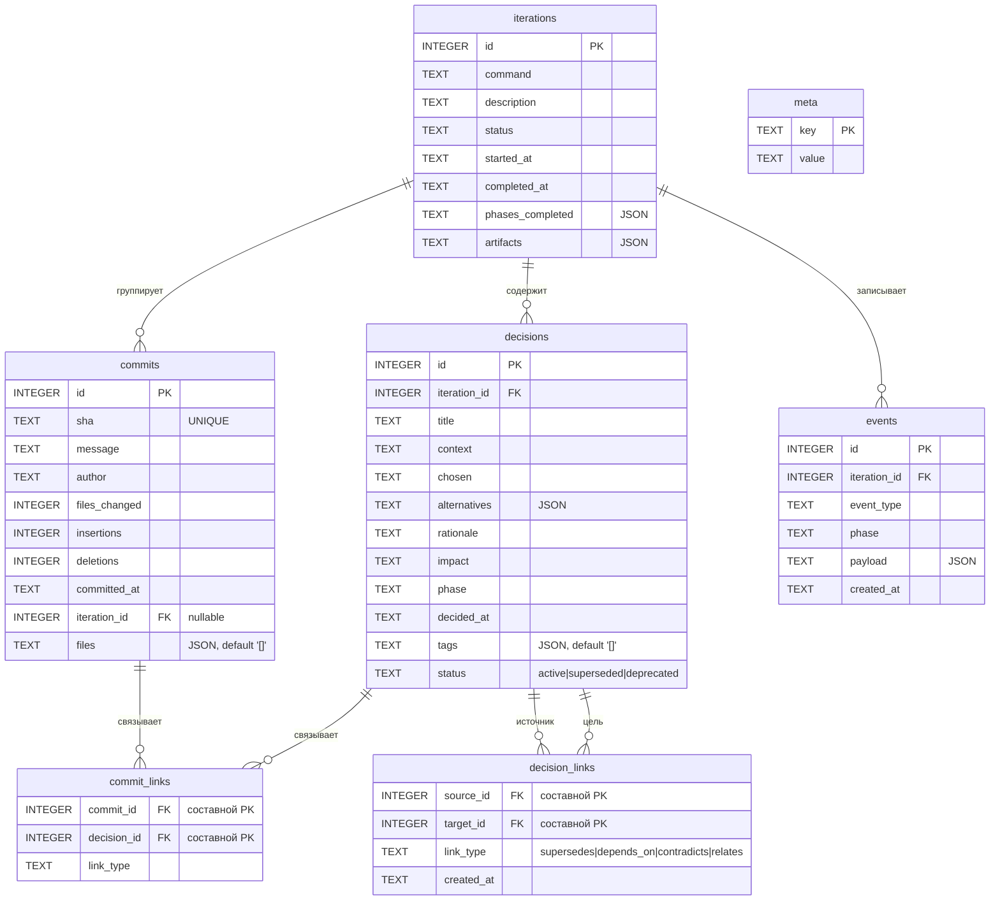
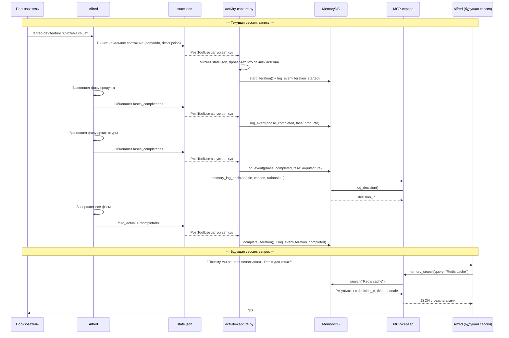

# Постоянная память

Разговоры в Claude Code по своей природе эфемерны: когда сессия заканчивается, весь накопленный контекст исчезает без следа. Это решения по дизайну, причины отказа от альтернатив, компромиссы между производительностью и сопровождаемостью, ход рассуждений, который привёл к конкретной архитектуре. Значит, каждый раз, когда разработчик открывает новую сессию, Alfred начинает с нуля. Если три недели назад после подробного анализа ограничений проекта решили использовать SQLite вместо PostgreSQL, Alfred этого не знает. Если отказались от подхода с Redis, потому что развёртывание не могло зависеть от внешних сервисов, Alfred этого тоже не помнит.

Постоянная память решает эту проблему: она хранит решения, итерации, коммиты и события процесса в локальной базе SQLite. У каждого проекта своя база в `.claude/alfred-memory.db`, изолированная от остальных. Благодаря этому слою Alfred может отвечать на вопросы вроде «почему мы решили не использовать ORM» или «что реализовали в итерации 3» с проверяемыми подтверждениями, а не догадками. Трассируемость полная: от решаемой проблемы до коммита, который её реализовал, включая отвергнутые альтернативы и обоснование каждого выбора.

Память это **настраиваемый боковой слой**. `load_config()` стартует с `enabled: false`, но bootstrap проекта создаёт `.claude/alfred-dev.local.md` с включённой памятью в первой сессии, если локального файла не было. Дальше пользователь может явно её выключить. Если память не активна, процесс плагина продолжает работать; просто у будущих сессий не будет доступа к истории.


## Схема базы данных

Схема рассчитана на четыре типа информации, которые дополняют друг друга. **Итерации** это полные рабочие циклы (feature, fix, spike); **решения** фиксируют формальное обоснование каждого выбора; **коммиты** связывают решения с реальным кодом; **события** записывают механическую хронологию процесса (завершённые фазы, пройденные gates).

Связи между таблицами позволяют восстановить полную историю изменения: от итерации, которая его начала, через решения, на которых оно основано, до коммитов, которые его воплотили. Промежуточная таблица `commit_links` задаёт трассируемость «многие-ко-многим» между коммитами и решениями: один коммит может реализовать несколько решений, а одно решение может потребовать нескольких коммитов.



### Подробности по каждой таблице

**iterations** хранит рабочие циклы. Поле `command` указывает тип процесса (`feature`, `fix`, `spike`, `ship`, `audit`). Поле `status` переходит из `active` в `completed` или `abandoned`. Поля `phases_completed` и `artifacts` это необязательный JSON, который дополняет запись.

**decisions** фиксирует формальное обоснование. У каждого решения есть короткий `title`, `context` проблемы, выбранный вариант `chosen`, отвергнутые `alternatives` (хранятся как JSON-массив), `rationale` с обоснованием выбора, `impact` (low, medium, high, critical) и `phase` процесса, на которой решение приняли. Если `iteration_id` не передан, решение автоматически привязывается к активной итерации. С v2 схемы у каждого решения есть `tags` (JSON-массив свободных меток, по умолчанию пустой) и `status` (`active`, `superseded` или `deprecated`, по умолчанию `active`), чтобы управлять его жизненным циклом без дублирования записей.

**commits** хранит метаданные коммитов Git. Поле `sha` уникально, это даёт идемпотентность: если попытаться записать уже существующий коммит, операция молча игнорируется. Поэтому автоматический захват может вызывать `log_commit()`, не заботясь о дубликатах. С v2 поле `files` (JSON-массив путей) хранит файлы, затронутые коммитом. Это упрощает поиск по файлу и трассируемость изменений.

**commit_links** связывает коммиты и решения. Поле `link_type` указывает тип связи: `implements` (коммит реализует решение), `reverts` (отменяет его) или `relates` (общая связь). Составной первичный ключ `(commit_id, decision_id)` не допускает дубликатов.

**decision_links** (v2) задаёт связи между парами решений. Поле `link_type` принимает четыре значения: `supersedes` (решение-источник заменяет решение-цель), `depends_on` (зависит от него), `contradicts` (конфликтует с ним) и `relates` (общая связь). Составной первичный ключ `(source_id, target_id)` не допускает дубликатов. Запросы двунаправленные: `get_decision_links(id)` возвращает и связи, где решение является источником, и связи, где оно является целью.

**events** фиксирует механические факты процесса: завершённые фазы, пройденные gates, одобрения. Поле `payload` это свободный JSON с дополнительными данными. События дают подробную хронологию, которую решения не покрывают.

**meta** хранит пары ключ-значение с внутренними метаданными: версия схемы (`schema_version`), дата создания (`created_at`), состояние FTS5 (`fts_enabled`).

### Индексы

Схема включает индексы, которые ускоряют самые частые запросы:

| Индекс | Таблица | Колонка | Назначение |
|--------|---------|---------|------------|
| `idx_iterations_status` | iterations | status | Быстро отфильтровать активные итерации |
| `idx_decisions_iteration` | decisions | iteration_id | Получить решения итерации |
| `idx_commits_iteration` | commits | iteration_id | Получить коммиты итерации |
| `idx_events_iteration` | events | iteration_id | Получить события итерации |
| `idx_events_type` | events | event_type | Отфильтровать события по типу |
| `idx_decision_links_target` | decision_links | target_id | Двунаправленный поиск связей между решениями |


## FTS5 (полнотекстовый поиск)

FTS5 это расширение SQLite для быстрого полнотекстового поиска. В памяти Alfred Dev оно позволяет искать по словам в решениях, коммитах и событиях с содержимым без операторов `LIKE %термин%`. Такие операторы медленные, потому что требуют полного прохода по таблице.

Причина использовать FTS5, а не только `LIKE`: производительность на масштабе. Проекту с сотнями решений и тысячами коммитов нужен быстрый поиск, чтобы Alfred отвечал на исторические вопросы без заметной задержки. FTS5 строит инвертированный индекс, и время поиска почти не зависит от размера таблицы.

### Виртуальная таблица `memory_fts`

Если FTS5 доступен, `MemoryDB` создаёт виртуальную таблицу `memory_fts` с тремя колонками:

| Колонка | Тип | Содержимое |
|---------|-----|------------|
| `source_type` | TEXT | Тип записи: `decision`, `commit` или `event` |
| `source_id` | TEXT | ID исходной записи (приведён к тексту) |
| `content` | TEXT | Индексируемый текст (конкатенация нужных полей) |

Для решений поле `content` объединяет `title`, `context`, `chosen`, `rationale` и `alternatives`. Для коммитов оно объединяет `message` и `files`. Для событий индексируемое содержимое собирается из `summary` и `content`.

### Триггеры синхронизации

Индекс FTS5 сочетает два механизма синхронизации:

- **`fts_insert_decision`**: срабатывает при вставке нового решения. Объединяет текстовые поля через `COALESCE`, чтобы обработать null, и вставляет их в `memory_fts`.
- **`fts_insert_commit`**: срабатывает при вставке нового коммита. Вставляет сообщение и затронутые файлы.
- **События с содержимым**: отдельного SQL-триггера нет; они индексируются в логике `MemoryDB.log_event()`, а при необходимости полный индекс перестраивается через `_rebuild_fts_index()`.

Такое сочетание держит индекс в актуальном состоянии и не заставляет описывать всю семантику событий декларативным SQL.

### Определение в runtime и fallback на LIKE

Не все сборки SQLite включают расширение FTS5. Проверку выполняет метод `_detect_fts5()` класса `MemoryDB`: он пытается создать временную таблицу FTS5 (`_fts5_test`). Если операция успешна, FTS5 доступен, и создаётся настоящая таблица с триггерами. Если возникает `OperationalError`, ставится `_fts_enabled = False`, и весь поиск использует `LIKE %термин%` как fallback.

Результат проверки сохраняется в таблице `meta` с ключом `fts_enabled` (`"1"` или `"0"`), чтобы другие компоненты, например MCP-сервер, могли прочитать его без повторной проверки.

Метод `search()` класса `MemoryDB` проверяет флаг `_fts_enabled` и автоматически делегирует `_search_fts()` или `_search_like()`. Для потребителя интерфейс одинаков в обоих случаях; меняется только скорость.


## Очистка секретов

База памяти могла бы сохранить секреты, если агент упомянет API-ключ в решении или если сообщение коммита по ошибке содержит учётные данные. Чтобы не допустить утечки, весь текст, который попадает в базу, проходит через `sanitize_content()`. Функция применяет 13 regex-шаблонов и заменяет каждое совпадение маркером `[REDACTED:<тип>]`.

Очистка идёт на слое хранения, а не на слое отображения, потому что вред от сохранённого секрета постоянен: если ключ попал в БД, любой будущий запрос может его раскрыть. Очистка до записи гарантирует, что чувствительная информация не попадает на диск.

Шаблоны те же, что использует хук `secret-guard.py`, чтобы вся цепочка безопасности плагина была согласованной. Порядок важен: более конкретные шаблоны идут первыми, чтобы общий шаблон не перехватил совпадение, которое должен поймать более точный.

### Обнаруживаемые шаблоны

| # | Метка | Что обнаруживает | Краткий шаблон |
|---|-------|------------------|----------------|
| 1 | `AWS_KEY` | Ключи доступа AWS | `AKIA` и 16 буквенно-цифровых символов |
| 2 | `ANTHROPIC_KEY` | API-ключи Anthropic | Префикс `sk-ant-` и 20+ символов |
| 3 | `SK_KEY` | Ключи с общим префиксом sk- (OpenAI и др.) | Префикс `sk-` и 20+ буквенно-цифровых символов |
| 4 | `GITHUB_TOKEN` | Персональные токены и PAT GitHub | Префиксы `ghp_` (36 символов) или `github_pat_` (20+ символов) |
| 5 | `SLACK_TOKEN` | Токены Slack (bot, app, user) | Префикс `xox[bpsa]-` и 10+ символов |
| 6 | `GOOGLE_KEY` | API-ключи Google | Префикс `AIza` и 35 символов |
| 7 | `SENDGRID_KEY` | API-ключи SendGrid | Префикс `SG.` и два сегмента по 22+ символа |
| 8 | `PRIVATE_KEY` | Приватные ключи (RSA, EC, DSA, OPENSSH) | Заголовок `-----BEGIN [...] PRIVATE KEY-----` |
| 9 | `JWT` | JWT-токены в Base64 | Три сегмента Base64URL, разделённые точками |
| 10 | `CONNECTION_STRING` | Строки подключения к базам данных | Протокол (mysql, postgresql, mongodb, redis, amqp) и учётные данные |
| 11 | `SLACK_WEBHOOK` | Webhooks Slack | URL `hooks.slack.com/services/...` |
| 12 | `DISCORD_WEBHOOK` | Webhooks Discord | URL `discord.com/api/webhooks/...` |
| 13 | `HARDCODED_CREDENTIAL` | Захардкоженные учётные данные в коде | Прямые присваивания вроде `api_key = "valor"` |

### Очищаемые поля

Эти поля базы проходят через `sanitize_content()` перед каждой записью:

| Таблица | Очищаемые поля |
|---------|----------------|
| decisions | `context`, `chosen`, `rationale`, `alternatives` (каждый элемент массива) |
| commits | `message` |
| events | `payload` (каждое строковое значение в словаре) |
| iterations | `description` |


## MCP-сервер

MCP-сервер (Model Context Protocol) это процесс, который открывает постоянную память как инструменты, доступные агентам Claude Code. Он общается по JSON-RPC 2.0 через stdin/stdout в текущем формате MCP (одно JSON-сообщение на строку) и умеет читать исторический framing `Content-Length`.

MCP-сервер нужен вместо прямого доступа агентов к БД из-за модели выполнения Claude Code: агенты не запускают произвольный Python, а вызывают инструменты, описанные в стандартном протоколе. Сервер переводит вызовы MCP в вызовы API `MemoryDB`.

### Жизненный цикл

Claude Code запускает сервер в начале сессии и держит его как постоянный процесс. Последовательность запуска:

1. **Определение пути**: БД лежит в `$PWD/.claude/alfred-memory.db`, относительно рабочего каталога проекта.
2. **Открытие соединения**: создаётся экземпляр `MemoryDB` с WAL и включёнными foreign keys. Открытие ленивое (откладывается до первого вызова инструмента).
3. **Схема**: `ensure_schema()` создаёт таблицы и индексы, если их нет. Если БД новая, записывает версию схемы и дату создания в `meta`.
4. **Определение FTS5**: `_detect_fts5()` проверяет поддержку FTS5 и создаёт виртуальную таблицу с триггерами, если она доступна.
5. **Очистка событий**: если `retention_days > 0`, удаляются события старше окна хранения.
6. **Ожидание**: сервер ждёт сообщений JSON-RPC из stdin.

### Открытые инструменты

Сервер открывает пятнадцать инструментов. Десять исходных покрывают поиск, запись и запросы; пять новых (v2) добавляют управление жизненным циклом решений, проверку целостности и экспорт/импорт. Каждый описан входной JSON Schema и внутри передаётся соответствующему методу `MemoryDB`.

#### `memory_search(query, limit?, iteration_id?)`

Ищет по тексту в памяти проекта (решения, коммиты и события с индексируемым содержимым). Использует FTS5, если он доступен, или `LIKE` как fallback. Возвращает список результатов с типом источника (`decision`, `commit` или `event`), полными данными записи и метаданными поиска (общее число результатов, активен ли режим FTS).

| Параметр | Тип | Обязателен | Описание |
|----------|-----|------------|----------|
| `query` | string | да | Текст для поиска |
| `limit` | integer | нет | Максимум результатов (по умолчанию 20) |
| `iteration_id` | integer | нет | Фильтр по конкретной итерации |
| `since` | string | нет | Минимальная дата (ISO 8601) для фильтрации |
| `until` | string | нет | Максимальная дата (ISO 8601) для фильтрации |
| `tags` | string[] | нет | Решения, у которых есть все указанные метки |
| `status` | string | нет | Фильтр решений по статусу (`active`, `superseded`, `deprecated`) |

#### `memory_log_decision(title, chosen, context?, alternatives?, rationale?, impact?, phase?)`

Записывает формальное решение по дизайну. Автоматически привязывает его к активной итерации, если не указана другая. Все текстовые поля очищаются до записи.

| Параметр | Тип | Обязателен | Описание |
|----------|-----|------------|----------|
| `title` | string | да | Короткий заголовок решения |
| `chosen` | string | да | Выбранный вариант |
| `context` | string | нет | Решаемая проблема |
| `alternatives` | string[] | нет | Отвергнутые варианты |
| `rationale` | string | нет | Обоснование выбора |
| `impact` | enum | нет | Уровень: `low`, `medium`, `high`, `critical` |
| `phase` | string | нет | Фаза процесса, на которой приняли решение |
| `tags` | string[] | нет | Свободные метки для классификации решения |

#### `memory_log_commit(sha, message?, decision_ids?, iteration_id?)`

Записывает коммит и при желании привязывает его к прошлым решениям. Если SHA уже есть, операция игнорируется (идемпотентно). Привязки создаются как связи типа `implements`.

| Параметр | Тип | Обязателен | Описание |
|----------|-----|------------|----------|
| `sha` | string | да | SHA-хеш коммита |
| `message` | string | нет | Сообщение коммита |
| `decision_ids` | integer[] | нет | ID решений для привязки |
| `iteration_id` | integer | нет | ID итерации (определяется автоматически, если не указан) |
| `files` | string[] | нет | Список файлов, затронутых коммитом |

#### `memory_get_iteration(id?)`

Возвращает полные данные итерации вместе со связанными решениями. Если ID не указан, возвращает активную итерацию; если активной нет, самую свежую.

| Параметр | Тип | Обязателен | Описание |
|----------|-----|------------|----------|
| `id` | integer | нет | ID итерации |

#### `memory_get_timeline(iteration_id)`

Возвращает полную хронологию событий итерации, от самого старого к самому новому. Позволяет восстановить точную последовательность фаз, gates и одобрений.

| Параметр | Тип | Обязателен | Описание |
|----------|-----|------------|----------|
| `iteration_id` | integer | да | ID итерации |

#### `memory_stats()`

Возвращает общую статистику памяти: счётчики итераций, решений, коммитов и событий; состояние FTS5; версию схемы и дату создания.

Параметров нет.

#### `memory_get_decisions(tags?, status?)`

Возвращает все записанные решения с необязательными фильтрами по меткам и статусу. Полезно для отфильтрованных списков без текстового запроса.

| Параметр | Тип | Обязателен | Описание |
|----------|-----|------------|----------|
| `tags` | string[] | нет | Фильтр по меткам (полное совпадение) |
| `status` | string | нет | Фильтр по статусу (`active`, `superseded`, `deprecated`) |

#### `memory_update_decision(id, status?, tags?)`

Обновляет статус или метки существующего решения без дублирования записей. Позволяет управлять жизненным циклом решений: пометить решение как `superseded`, когда его заменили, или как `deprecated`, когда оно потеряло актуальность.

| Параметр | Тип | Обязателен | Описание |
|----------|-----|------------|----------|
| `id` | integer | да | ID решения для обновления |
| `status` | string | нет | Новый статус: `active`, `superseded` или `deprecated` |
| `tags` | string[] | нет | Метки для добавления (существующие не дублируются) |

#### `memory_link_decisions(source_id, target_id, link_type)`

Создаёт направленную связь между двумя решениями. Позволяет строить граф эволюции и зависимостей решений проекта.

| Параметр | Тип | Обязателен | Описание |
|----------|-----|------------|----------|
| `source_id` | integer | да | ID решения-источника |
| `target_id` | integer | да | ID решения-цели |
| `link_type` | string | да | Тип связи: `supersedes`, `depends_on`, `contradicts`, `relates` |

#### `memory_health()`

Проверяет целостность базы памяти. Проверяет версию схемы, синхронизацию FTS5, права файла (0600) и размер базы (предупреждение, если больше 50 MB). Возвращает отчёт с общим состоянием (`healthy`, `warnings`, `errors`) и списком найденных проблем.

Параметров нет.

#### `memory_export(format, path?, iteration_id?)`

Экспортирует решения в файл Markdown в формате, похожем на ADR (Architecture Decision Record). Каждое решение включает дату, статус, метки, контекст, выбранный вариант, отвергнутые альтернативы, обоснование и связанную итерацию.

| Параметр | Тип | Обязателен | Описание |
|----------|-----|------------|----------|
| `format` | string | да | Формат экспорта (сейчас только `markdown`) |
| `path` | string | нет | Путь к выходному файлу, всегда внутри текущего проекта |
| `iteration_id` | integer | нет | Экспортировать только решения конкретной итерации |

#### `memory_import(source, path?, limit?)`

Импортирует данные из внешних источников в постоянную память. Поддерживает два источника: `git` (импорт коммитов из истории Git) и `adr` (импорт решений из файлов Markdown в формате ADR).

| Параметр | Тип | Обязателен | Описание |
|----------|-----|------------|----------|
| `source` | string | да | Источник импорта: `git` или `adr` |
| `path` | string | нет | Путь к репозиторию (git) или каталогу ADR (adr), всегда внутри текущего проекта |
| `limit` | integer | нет | Максимум записей для импорта (по умолчанию 100, максимум 1000, только git) |


## Запросы к памяти

Агента `librarian` нет. Интерфейс запросов: MCP-сервер `alfred-memory` и `/alfred-dev:memory-ui`. Каждый показанный факт должен прослеживаться до источника. Если в памяти нет записей, это говорится прямо.

### Классификация вопросов

Перед запросом к памяти Alfred относит каждый вопрос к одной из четырёх категорий, чтобы выбрать подходящий MCP-инструмент:

| Категория | Тип вопроса | Основной инструмент | Пример |
|-----------|-------------|---------------------|--------|
| Решение | что / почему | `memory_search` | «Почему мы используем SQLite вместо PostgreSQL» |
| Реализация | какой коммит | `memory_search` (коммиты) | «В каком коммите добавили хук безопасности» |
| Хронология | когда | `memory_get_timeline` | «Что было в итерации 3» |
| Статистика | сколько | `memory_stats` | «Сколько решений записано» |

### Формат ссылок

Каждый ответ с данными из памяти должен ссылаться на источник. Допустимые форматы:

| Тип | Формат | Пример |
|-----|--------|--------|
| Решение | `[D#<id>]` | `[D#12] 2026-02-15 -- Использовать SQLite` |
| Коммит | `[C#<sha_corto>]` | `[C#a1b2c3d] 2026-02-16 -- feat: постоянная память` |
| Итерация | `[I#<id>]` | `[I#5] feature -- Система памяти` |
| Событие | `[E#<id>]` | `[E#42] phase_completed 2026-02-15` |

Если Alfred не может сослаться на конкретный источник, он не включает факт в ответ. Исключений у этого правила нет.


## Автоматический захват

С v0.3.6 автоматический захват собран в одном хуке: `activity-capture.py`. Он заменяет прежние `memory-capture.py` и `commit-capture.py`, которые объединили, чтобы упростить сопровождение и расширить охват захвата.

### activity-capture.py (централизованный захват)

Скрипт зарегистрирован в `UserPromptSubmit` и в `PostToolUse` для `Write|Edit` и `Bash`. Это fail-open хук: он не блокирует операцию и не мешает рабочему процессу. Плагин не регистрирует `UserPromptExpansion`, `PreCompact` и `Stop`. Если что-то ломается (нет БД, повреждён JSON, нет конфигурации), хук пишет предупреждение в stderr и выходит с `exit 0`.

Захват автоматизирован, а не оставлен агентам, ради надёжности: агент может забыть вызвать `memory_log_event()`, а хук срабатывает всегда, потому что подключён к жизненному циклу инструментов.

Каждое событие записывается с тремя уровнями детализации: читаемый `summary`, структурированный JSON `payload` для программной фильтрации и `content` для запросов по требованию. Для событий большого объёма, таких как `Glob`, `Grep`, `WebFetch` или `WebSearch`, `content` может сохраняться как обрезанный preview с метаданными (`content_truncated`, `content_lines`, `content_chars`), чтобы память не заполнялась бесполезными списками или HTML-блобами.

### Логика захвата итераций и фаз

Когда хук видит запись в `alfred-dev-state.json`, он выполняет три проверки подряд:

1. **Новая итерация**: если в БД нет активной итерации, начинается новая с данными из состояния (`comando`, `descripcion`) и записывается событие `iteration_started`.

2. **Завершённые фазы**: сравнивает завершённые фазы нового состояния с уже записанными в БД событиями `phase_completed`. Для каждой новой фазы без события записывает `phase_completed` с именем фазы, результатом, датой завершения и созданными артефактами.

3. **Завершённая итерация**: если `fase_actual` в состоянии равна `"completado"`, закрывает активную итерацию и записывает событие `iteration_completed`.

### Захват коммитов

Когда диспетчер Bash видит успешную команду `git commit` (exit code 0), он выполняет `git log -1 --format=%H|%s|%an|%aI --name-only`, чтобы получить SHA, сообщение, автора, дату и файлы. Затем записывает их через `MemoryDB.log_commit()`, который идемпотентен по SHA.

### Предварительная проверка

Перед обработкой любого события хук проверяет, что память включена, читая `.claude/alfred-dev.local.md`. Он ищет шаблон `memoria:` с последующим `enabled: true` через регулярное выражение, которое допускает комментарии и другие ключи между ними. Также он автоматически исключает файлы внутренних путей и тривиальные команды, чтобы не было шума.


## Полный поток захвата и запросов

Диаграмма показывает, как связаны все компоненты: от действия пользователя до исторического запроса в будущей сессии.




## Жизненный цикл базы данных

База создаётся автоматически, когда память впервые включается в проекте. Создание идёт в продуманной последовательности, чтобы обеспечить безопасность и целостность с первого момента.

### Создание

Конструктор `MemoryDB` создаёт родительский каталог (`.claude/`), если его нет, открывает соединение SQLite и выполняет такую последовательность:

1. **PRAGMA journal_mode=WAL**: включает режим Write-Ahead Logging, который позволяет параллельное чтение во время записи. Это важно, потому что MCP-сервер и хук захвата могут обращаться к БД одновременно.

2. **PRAGMA foreign_keys=ON**: включает ограничения внешних ключей. Без этой pragma SQLite игнорирует объявления `REFERENCES` и допускает несогласованность (например, решение, которое ссылается на несуществующую итерацию).

3. **ensure_schema()**: создаёт таблицы и индексы, если их нет. Если БД новая, записывает `schema_version` и `created_at` в таблицу `meta`.

4. **_detect_fts5()**: проверяет поддержку FTS5 и создаёт виртуальную таблицу с триггерами, если она доступна.

5. **chmod 0600**: ставит строгие права (читать и писать может только владелец). Если файловая система не поддерживает `chmod` (например, FAT32), работа продолжается без строгих прав.

### Хранение

Политика хранения различает типы данных по их долгосрочной ценности:

| Тип данных | Политика хранения | Причина |
|------------|-------------------|---------|
| Решения | Не удаляются никогда | Обоснование решения ценно бессрочно |
| Итерации | Не удаляются никогда | Это контекст решений и коммитов |
| Коммиты | Не удаляются никогда | Это связь с реальным кодом |
| События | Удаляются после `retention_days` | Это механические данные, их ценность со временем падает |

Очистка событий выполняется автоматически при запуске MCP-сервера. Метод `purge_old_events()` удаляет события, у которых `created_at` раньше текущей даты минус `retention_days`, и очищает их строки в `memory_fts`. Значение по умолчанию: 365 дней. Его можно задать через переменную окружения `ALFRED_MEMORY_RETENTION_DAYS` или ключ `memoria.retention_days` в конфигурации проекта.

### Версионирование схемы

Таблица `meta` хранит версию схемы под ключом `schema_version`. Текущая версия: `4`.

С v0.2.3 есть механизм автоматической миграции. При открытии базы `MemoryDB` сравнивает сохранённую версию с `_SCHEMA_VERSION`. Если она ниже, выполняет ожидающие миграции в одной транзакции и перед изменением схемы создаёт резервную копию (`.bak`). Словарь `_MIGRATIONS` связывает каждую версию со списком SQL-команд для миграции с предыдущей версии.

Миграция с v1 на v2 добавляет три колонки (`decisions.tags`, `decisions.status`, `commits.files`) и создаёт таблицу `decision_links` с индексом. Миграция с v2 на v3 добавляет исторические вспомогательные таблицы, а с v3 на v4 добавляет `summary` и `content` в `events` для полного захвата и индексации событий. Это операции `ALTER TABLE` и `CREATE TABLE`, они безопасны и не требуют перезаписи существующих данных.


## Конфигурация

Постоянная память настраивается в секции `memoria` файла `.claude/alfred-dev.local.md` проекта. Её также можно настроить интерактивно через `/alfred-dev:ajustes`.

### Ключи конфигурации

| Ключ | Тип | По умолчанию | Описание |
|------|-----|--------------|----------|
| `enabled` | boolean | `false` | Включает или выключает постоянную память |
| `sync_to_native` | boolean | `true` | Проецировать SQLite в нативную память `.md` Claude Code |
| `sync_commits_limit` | integer | `10` | Сколько последних коммитов проецировать в нативную память |
| `capture_decisions` | boolean | `true` | Автоматически записывать решения по дизайну |
| `capture_commits` | boolean | `true` | Автоматически записывать коммиты |
| `retention_days` | integer | `365` | Сколько дней хранить события (решения и итерации не удаляются) |

### Минимальный пример включения

Чтобы включить память со значениями по умолчанию, достаточно добавить во frontmatter файла конфигурации:

```yaml
---
memoria:
  enabled: true
---
```

### Полный пример

```yaml
---
memoria:
  enabled: true
  sync_to_native: true
  sync_commits_limit: 10
  capture_decisions: true
  capture_commits: true
  retention_days: 365

agentes_opcionales:
  cto: false
---
```

Память работает без CTO. Исторические запросы идут через MCP или `/alfred-dev:memory-ui`.


## Исходные файлы для справки

| Файл | Содержимое |
|------|------------|
| `core/memory.py` | Класс `MemoryDB`, функция `sanitize_content()`, SQL-схема, миграции, шаблоны секретов, логика FTS5 |
| `mcp/memory_server.py` | Класс `MemoryMCPServer`, 15 MCP-инструментов, транспорт JSON-RPC stdio |
| `hooks/activity-capture.py` | Хук захвата в UserPromptSubmit и PostToolUse (Write/Edit/Bash). Включает отслеживание итераций/фаз и захват коммитов. |
| `hooks/session-start.sh` | Брифинг сессии с решениями и ADR |
| `commands/memory-ui.md` | Локальный GET-просмотрщик памяти SQLite |
