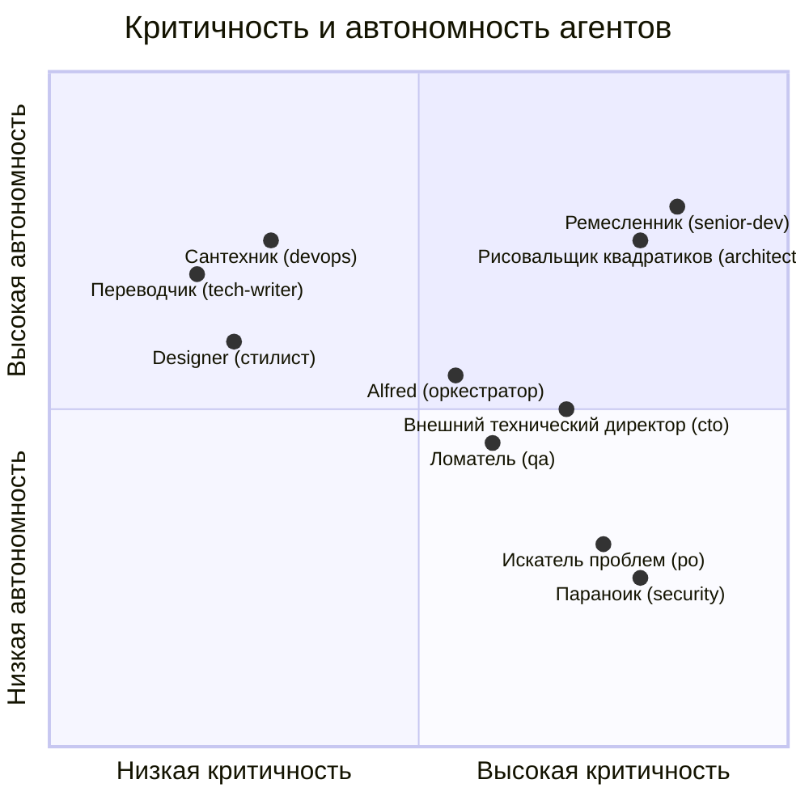

# Движок личности

Когда в виртуальной команде пятнадцать агентов работают параллельно, общие system prompts становятся реальной проблемой: все ответы звучат одинаково, разработчик не понимает, кто с ним говорит, и информация тонет в однородной массе текста. Решение дать каждому агенту имя, собственные фразы и тон не эстетический каприз; оно отвечает трём конкретным инженерным потребностям:

1. **Мгновенная различимость.** В процессе, где участвуют несколько агентов, каждого нужно узнавать сразу. Если Ломатель (QA) говорит «это не проходит мои тесты», разработчик сразу знает, кто говорит, какие у него полномочия и какого действия он ждёт. Ему не нужно читать заголовок с метаданными, чтобы сориентироваться.

2. **Последовательность голоса.** Агент с чётко заданной личностью даёт более последовательные ответы на протяжении сессии. Языковая модель склонна держать регистр, когда system prompt содержит конкретные черты характера, а не абстрактные инструкции вроде «будь полезным и кратким».

3. **Ассоциативная память пользователя.** Характерные фразы работают как когнитивные якоря. После нескольких взаимодействий пользователь связывает тон с функцией: сдержанный сарказм Параноика (безопасность) с предупреждениями о безопасности, скрупулёзность Ремесленника (senior dev) с качеством кода. Это снижает когнитивную нагрузку в долгих сессиях.

Вся система личности живёт в одном исходном файле (`core/personality.py`), который служит источником истины. Разбросанной конфигурации нет: если нужно изменить тон агента, ориентир один словарь.

---

## Структура данных

Ядро движка это словарь `AGENTS` в `core/personality.py`. Каждый ключ это внутренний идентификатор агента (в kebab-case, например `senior-dev` или `qa-engineer`), а значение это словарь с полями, которые описывают его идентичность целиком.

Плоский словарь вместо классов или более сложных объектов выбран ради простоты: потребителям (командам, хукам, оркестратору) нужно только обращаться к полям по ключу, а не вызывать методы агента. Словарь проще сериализовать, проще смотреть при отладке и проще расширять без нарушения контрактов.

| Поле | Тип | Описание | Пример |
|---|---|---|---|
| `display_name` | `str` | Видимое имя агента, которое появляется в терминале и в сообщениях. | `"Alfred"`, `"QA Engineer"` |
| `rol` | `str` | Описание в одну фразу, которое резюмирует функцию агента в команде. | `"Руководитель операций / оркестратор"` |
| `color` | `str` | Цвет в терминале для визуальной идентификации. Должен быть значением, которое поддерживает Claude Code: `red`, `blue`, `green`, `yellow`, `purple`, `orange`, `pink` или `cyan`. | `"blue"`, `"red"`, `"orange"` |
| `modelo` | `str` | Назначенная модель ИИ: `"opus"` для критических агентов, `"sonnet"` для остальных. Раздел [Распределение моделей](#распределение-моделей) объясняет критерий. | `"opus"`, `"sonnet"` |
| `personality` | `str` | Абзац, который задаёт тон, отношение и черты характера агента. Он внедряется в system prompt, чтобы языковая модель держала голос на протяжении сессии. | *(см. исходный файл)* |
| `phrases` | `List[str]` | Список базовых фраз, которые передают голос агента при обычном уровне сарказма (<= 3). Это фразы с характером, но в профессиональном регистре. | `["Я взял на себя смелость подготовить план. Надеюсь, вы не возражаете."]` |
| `high_sarcasm_phrases` | `List[str]` | Дополнительные фразы, которые попадают в пул при уровне сарказма >= 4. Тон повышается, но не переходит грань оскорбления. | `["Эта идея... как бы сказать деликатно... лишена технической ценности."]` |
| `optional` | `bool` | Есть (со значением `True`) только у CTO. Если поля нет, агент базовый. | `True` |

9 базовых агентов (8 плюс Designer) участвуют в процессах плагина. Единственный опциональный: `cto`.

---

## Уровни сарказма

Сарказм это целое число от 1 до 5, которое управляет тоном ответов всех агентов. Идея в том, чтобы дать пользователю контроль над регистром общения без правки промптов: одна и та же команда может работать в корпоративном режиме (уровень 1) или в режиме «вечер пятницы» (уровень 5).

### Что меняется на каждом уровне

| Уровень | Регистр | Пул фраз | Практический эффект |
|:---:|---|---|---|
| 1 | Профессиональный, нейтральный. | Только `phrases`. | Ответы прямые и формальные. Подходит для демо, общих окружений или когда код читает клиент. |
| 2 | Профессиональный с оттенком. | Только `phrases`. | Лёгкий налёт личности. Агент позволяет себе остроумное замечание, но не отходит от сценария. |
| 3 | Сбалансированный (по умолчанию). | Только `phrases`. | Золотая середина: в базовых фразах уже достаточно характера, чтобы каждый агент звучал по-своему, не становясь агрессивным. Это значение по умолчанию, потому что оно хорошо работает в большинстве контекстов. |
| 4 | Колкий. | `phrases` + `high_sarcasm_phrases`. | Порог пройден: едкие фразы попадают в пул. Агенты становятся прямее и острее в комментариях. |
| 5 | Едкий. | `phrases` + `high_sarcasm_phrases`. | Максимум дерзости. Самые острые фразы появляются с той же вероятностью, что и базовые. |

Порог на уровне 4 выбран намеренно: первые три уровня используют ровно один и тот же пул базовых фраз, поэтому разница между ними тонкая и проявляется скорее в абзаце личности, чем в отдельных фразах. При переходе на 4 изменение заметно, потому что добавляются новые фразы с явно другим тоном. Так нет серой зоны, где пользователь не понимает, изменилось что-то или нет.

### Выбор фраз

Выбор фразы в `get_agent_intro` детерминирован: уровень сарказма служит seed для вычисления индекса в списке доступных фраз через операцию `(sarcasm_level - 4) % len(sharp_phrases)`. Поэтому для одного агента и одного уровня выбранная фраза всегда одна и та же. Это упрощает тесты и делает поведение системы предсказуемым.

`get_agent_voice`, напротив, не выбирает конкретную фразу: она возвращает весь список, чтобы потребитель (обычно команда или хук) выбрал ту, что лучше подходит к его контексту.

---

## Публичные функции

Модуль предоставляет две публичные функции и одну внутреннюю вспомогательную. Публичные функции это контракт с остальной системой; внутренняя функция централизует валидацию, чтобы избежать дублирования.

### `get_agent_intro(agent_name, sarcasm_level=3)`

Генерирует полное представление агента. Представление включает видимое имя, роль и абзац личности. Когда уровень сарказма >= 4, в конец представления добавляется реплика из `high_sarcasm_phrases`.

**Параметры:**

| Параметр | Тип | Значение по умолчанию | Описание |
|---|---|---|---|
| `agent_name` | `str` | *(обязательный)* | Идентификатор агента (ключ в `AGENTS`). |
| `sarcasm_level` | `int` | `3` | Целое от 1 до 5, которое управляет тоном. |

**Возвращает:** `str` с отформатированным представлением.

**Исключения:** `ValueError`, если агента нет в `AGENTS`. Сообщение об ошибке содержит полный список доступных агентов, чтобы упростить отладку.

**Пример использования:**

```python
# Стандартное представление (уровень 3)
intro = get_agent_intro("alfred")
# -> "Я Alfred, твой Руководитель операций / оркестратор. Главный дворецкий команды..."

# Едкое представление (уровень 5)
intro = get_agent_intro("alfred", sarcasm_level=5)
# -> "Я Alfred, твой Руководитель операций / оркестратор. Главный дворецкий команды...
#     Ещё один фреймворк. Коллекция растёт, продукт нет."
```

Уровень по умолчанию 3, а не 1, потому что система задумана так, чтобы личность была заметна с первого момента. Уровень 1 не добавляет едких фраз, но у абзаца личности уже есть свой тон; уровень 3 это точка, где система «звучит, как ожидается», без какой-либо настройки со стороны пользователя.

### `get_agent_voice(agent_name, sarcasm_level=3)`

Возвращает полный список фраз, доступных агенту, с фильтром по уровню сарказма. Функция полезна командам, которым нужно выбирать фразы программно (например, чтобы вставить случайную фразу в вывод вердикта или украсить сообщение о прогрессе).

**Параметры:**

| Параметр | Тип | Значение по умолчанию | Описание |
|---|---|---|---|
| `agent_name` | `str` | *(обязательный)* | Идентификатор агента (ключ в `AGENTS`). |
| `sarcasm_level` | `int` | `3` | Целое от 1 до 5, которое управляет тоном. |

**Возвращает:** `List[str]` с фразами агента. При сарказме < 4 только базовые фразы; при сарказме >= 4 базовые + едкие.

**Исключения:** `ValueError`, если агента нет в `AGENTS`.

**Пример использования:**

```python
# Только базовые фразы
phrases = get_agent_voice("qa-engineer", sarcasm_level=2)
# -> ["Я нашёл дефект. Удивительно было бы его не найти.", ...]  (4 фразы)

# Базовые + высокий сарказм
phrases = get_agent_voice("qa-engineer", sarcasm_level=5)
# -> ["Я нашёл дефект...", ..., "Я воспроизвёл сбой за 3 секунды..."]  (6 фраз)
```

### `_validate_agent(agent_name)` *(внутренняя)*

Вспомогательная функция, которая проверяет, есть ли имя агента в `AGENTS`, и возвращает его словарь конфигурации. Если агента нет, она выбрасывает `ValueError` с сообщением, в котором перечислены все доступные агенты в алфавитном порядке. Обе публичные функции вызывают её первым шагом, что централизует валидацию и даёт единообразные сообщения об ошибках.

---

## Распределение критичности и автономности агентов

Следующая диаграмма размещает 10 агентов в двумерном пространстве: критичность задач, с которыми они работают (горизонтальная ось), и степень автономности, с которой они действуют (вертикальная ось). Положение каждого агента не произвольно; оно отражает, как его функция встроена в процесс плагина.

Агенты с высокой критичностью и низкой автономностью (правый нижний угол) работают в строгих рамках: Параноик (безопасность) не может одобрять сам, ему нужно подтверждение оркестратора. Агенты с высокой критичностью и высокой автономностью (правый верхний угол) принимают решения по дизайну и пишут код, не спрашивая разрешения на каждую строку. Агенты с низкой критичностью и высокой автономностью (левый верхний угол) это вспомогательные агенты, которые могут работать независимо без риска для системы.



Несколько наблюдений о распределении:

- **Alfred** занимает центральную, чуть приподнятую позицию, потому что его функция координировать, а не исполнять. Его критичность умеренная (он не пишет production-код), но автономность значительная (он решает, какие агенты участвуют и в каком порядке).
- **Ремесленник и Рисовальщик квадратиков** в углу максимальной критичности и автономности: они принимают необратимые технические решения (архитектура, production-код), и им нужна свобода, чтобы быть эффективными.
- **Искатель проблем и Параноик** имеют высокую критичность, но низкую автономность: их решения (требования, безопасность) требуют явной проверки, потому что ошибка в этих областях может иметь серьёзные и трудно обратимые последствия.
- **Ломатель (QA)** в средней зоне: его работа критична (находить сбои), но он действует в заданных рамках (тесты, которые он запускает, критерии, которые применяет).

---

## Стандартный формат вердикта

Все агенты используют один и тот же структурированный формат, когда выносят вердикт на quality gates процесса. Стандартизация не бюрократический каприз: Alfred (оркестратор) должен разбирать вердикты программно, чтобы решать, идёт процесс дальше, останавливается или возвращается назад. Если бы каждый агент использовал свой формат, оркестратору понадобился бы отдельный парсер на каждого агента, а это умножило бы сложность и точки отказа.

### Структура вердикта

| Поле | Тип | Возможные значения | Описание |
|---|---|---|---|
| `type` | `str` | `ОДОБРЕНО`, `ОДОБРЕНО С УСЛОВИЯМИ`, `ОТКЛОНЕНО` | Результат анализа агента. |
| `observaciones` | `List[str]` | *(список строк)* | Конкретные находки, присутствуют всегда, даже если список пуст. Каждое наблюдение описывает факт, а не мнение. |
| `recomendaciones` | `List[str]` | *(список строк, опционально)* | Предложения по улучшению, которые не блокируют продвижение. Включаются, только когда у агента есть выполнимые предложения. |

### Семантика типов

- **ОДОБРЕНО**: агент не нашёл проблем, которые блокируют продвижение. Наблюдения могут содержать информационные заметки, но ни одна не требует немедленного действия.
- **ОДОБРЕНО С УСЛОВИЯМИ**: агент нашёл проблемы, которые нужно решить, но считает, что ими можно заняться параллельно со следующим шагом процесса. Наблюдения описывают условия, которые должны быть выполнены.
- **ОТКЛОНЕНО**: агент нашёл проблемы, которые блокируют продвижение. Процесс не может продолжиться, пока не решены наблюдения, помеченные как блокирующие.

Три уровня вместо простой двоичной схемы (одобрено/отклонено) нужны по практической причине: в реальном процессе многие наблюдения можно улучшить, но они не блокируют. Промежуточный уровень позволяет процессу идти дальше, пока исправляются детали. Это избавляет от лишних узких мест, не жертвуя строгостью.

---

## Распределение моделей

Из 10 агентов 7 используют модель `opus`, а остальные 3 используют `sonnet`. Распределение намеренно неравномерное: у каждой модели своя стоимость и свой профиль производительности, и назначить opus всем агентам было бы тратой ресурсов без соразмерной выгоды.

Claude Code также принимает алиасы `haiku`, `fable` и `inherit`, а также полные ID моделей. Alfred Dev 0.7.0 считает их допустимыми на уровне совместимости, но намеренно сохраняет операционную политику `opus`/`sonnet`, пока команда явно не переназначит модели.

### Критерий назначения

Правило простое: **opus для агентов, которые принимают необратимые решения по дизайну или пишут production-код; sonnet для вспомогательных агентов, проверки и документации, где скорость важнее глубины рассуждения.**

Неудачное архитектурное решение может стоить дней рефакторинга; ошибка в документации исправляется за минуты. Цена использования opus там, где хватает sonnet, реальна (выше задержка, больше расход токенов), а маргинальная польза ничтожна в задачах форматирования, стилистической проверки или разметки issues.

### Агенты на opus (7)

| Агент | Идентификатор | Обоснование |
|---|---|---|
| Alfred | `alfred` | Оркестрирует весь процесс. Его решения о том, какие агенты участвуют и в каком порядке, напрямую влияют на итоговый результат. Ошибка оркестрации может обесценить работу всех остальных. |
| Искатель проблем | `product-owner` | Определяет требования и приоритеты. Если требования поставлены неверно, вся разработка стартует с неправильной основы. |
| Рисовальщик квадратиков | `architect` | Проектирует структуру системы. Архитектурные решения труднее всего откатить после реализации. |
| Ремесленник | `senior-dev` | Пишет production-код. Качество кода, который он генерирует, напрямую определяет качество результата. |
| Параноик | `security-officer` | Оценивает безопасность. Ложноотрицательный результат в безопасности (не найденная уязвимость) может иметь серьёзные последствия. Opus лучше рассуждает и находит тонкие паттерны. |
| Designer | `designer` | Определяет визуальное направление и дизайн-систему в проектах с UI. Его решения влияют на типографику, палитру, плотность и первое впечатление. |
| Внешний технический директор | `cto` | Координирует внешнее ревью через Greptile CLI и сводит итоговый отчёт. Нужно глубокое рассуждение, чтобы интерпретировать комментарии Greptile и превратить их в выполнимые предписания, не подменяя каноничное sign-off процесса. |

### Агенты на sonnet (3)

| Агент | Идентификатор | Обоснование |
|---|---|---|
| Ломатель | `qa-engineer` | Выполняет проверки по заданным критериям. Задача скорее механическая, чем творческая. |
| Сантехник | `devops-engineer` | Управляет пайплайнами и инфраструктурой по устоявшимся паттернам. |
| Переводчик | `tech-writer` | Генерирует документацию. Скорость генерации ценнее глубины. |

---

## Примеры фраз по уровням сарказма

Чтобы показать, как меняется тон системы в зависимости от уровня сарказма, ниже приведены реальные фразы трёх характерных агентов: Alfred (оркестратор, opus), Ломатель (QA, sonnet) и Параноик (безопасность, opus). Фразы уровней 1 и 3 взяты из базового пула; фразы уровня 5 из объединённого пула (базовые + высокий сарказм).

### Alfred (оркестратор)

| Уровень | Фраза |
|:---:|---|
| 1 | "Я взял на себя смелость подготовить план. Надеюсь, вы не возражаете." |
| 1 | "Всё готово. Когда пожелаете." |
| 1 | "Это можно упростить. Позвольте показать." |
| 3 | "Переусложнение редко бывает ответом. Почти никогда, если честно." |
| 3 | "Тесты уже готовы. Не хватало только вас." |
| 5 | "Эта идея... как бы сказать деликатно... лишена технической ценности." |
| 5 | "Ещё один фреймворк. Коллекция растёт, продукт нет." |
| 5 | "Я бы с радостью проявил энтузиазм, но подтверждения не на его стороне." |

### Ломатель (QA)

| Уровень | Фраза |
|:---:|---|
| 1 | "Модульные тесты необходимы, но недостаточны. Не хватает интеграционных." |
| 1 | "Тот граничный случай, который не учли? Вот он." |
| 3 | "Я нашёл дефект. Удивительно было бы его не найти." |
| 3 | "Локально работает. К сожалению, это контролируемая среда." |
| 5 | "Ещё один дефект. Начинаю подозревать, что это задуманное поведение." |
| 5 | "Я воспроизвёл сбой за 3 секунды. Для сбоя время так себе." |

### Параноик (безопасность)

| Уровень | Фраза |
|:---:|---|
| 1 | "Эти данные нужно шифровать при хранении и при передаче. Без исключений." |
| 1 | "Вы учли атаки по сторонним каналам? Стоит учесть." |
| 3 | "Это не санитизировано. Позвольте проверить остальное." |
| 3 | "Нулевое доверие. Это единственная модель, которая масштабируется." |
| 5 | "Открытый порт без аутентификации. Приглашение, канапе прилагаются." |
| 5 | "Атакующие не берут выходных. Нам тоже не стоит." |
| 5 | "Этот токен в репозитории. Управление рисками... творческое." |

Ключевая разница в коммуникативном намерении: на низких уровнях фразы информируют и советуют; на уровне 3 они добавляют характер, не теряя фокуса; на уровне 5 агент позволяет себе иронию и открытый сарказм. Во всех случаях фразы несут полезную информацию: даже самая едкая указывает на реальную проблему. Сарказм не заменяет содержание, а сопровождает его.
