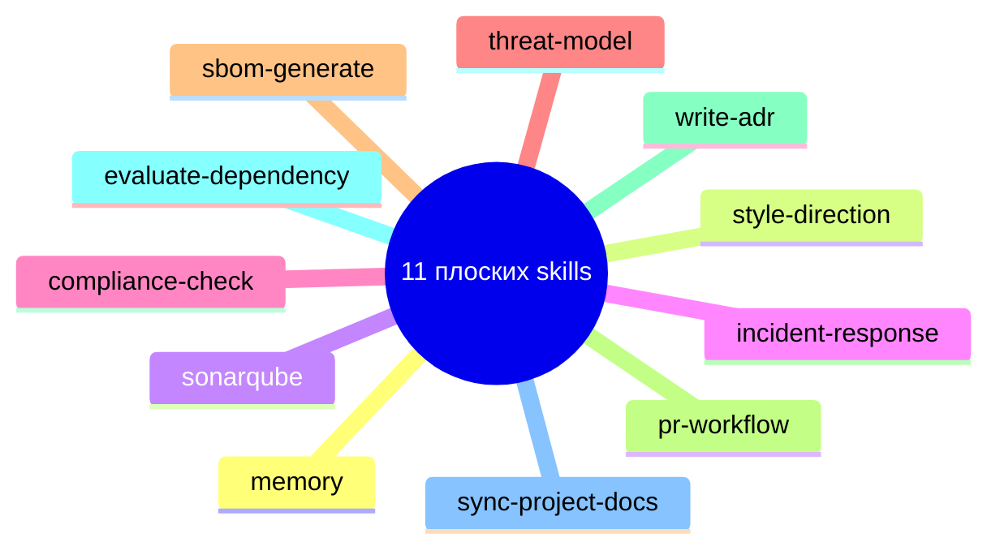

# Каталог skills

Skills это конкретные возможности, которые могут выполнять агенты Alfred. Каждый skill это файл Markdown (`SKILL.md`) с пошаговыми инструкциями для конкретной задачи: от проектирования схемы базы данных до аудита доступности интерфейса. Агенты не начинают с чистого листа: они следуют инструкциям назначенного skill, чтобы результат был более последовательным, проверяемым и его было легко сверить с подтверждениями.

Skills отделены от агентов по той же причине, по которой компания отделяет процедуры от ролей: процедуру (skill) могут выполнять разные люди (агенты) в зависимости от контекста, а одна роль может владеть несколькими процедурами. Такое разделение позволяет системе расти, не привязывая возможности к идентичностям.

Репозиторий поддерживает **каталог из 11 skills**, плоских, в `skills/<имя>/SKILL.md`. Они покрывают собственный процесс Alfred: memory, визуальный стиль, SonarQube, инциденты, compliance, threat-model, SBOM, процесс PR, ADR, оценку зависимостей и синхронизацию живой документации.

Skills с побочными эффектами (SonarQube, визуальный companion, incident-response, pr-workflow) имеют `disable-model-invocation: true`.

## Карта



| Skill | Назначение |
|-------|------------|
| `memory` | Запросы к памяти SQLite и политика записи в неё |
| `style-direction` | Визуальное направление Designer |
| `sonarqube` | Preflight и анализ SonarQube |
| `incident-response` | Реагирование на инциденты |
| `compliance-check` | Проверки compliance |
| `threat-model` | Threat model |
| `sbom-generate` | Генерация SBOM |
| `pr-workflow` | Процесс pull request |
| `write-adr` | Architecture Decision Records в `docs/adr/` |
| `evaluate-dependency` | Вердикт по новым пакетам |
| `sync-project-docs` | Индекс и синхронизация `docs/project/` |

## Как выполняются skills

Skills не заменяют slash-команды. Claude Code находит их в `skills/<имя>/SKILL.md`. Пользователь работает с процессами (`/alfred-dev:feature`, `/alfred-dev:fix`, `/alfred-dev:audit` и т. д.), а Alfred использует skill, если тот добавляет процедуру.

Единственный опциональный агент runtime: CTO. Designer подключается, если есть фронтенд. Нет data-engineer, github-manager, copywriter и остального каталога 0.6.

---

## Как создать новый skill

Новый skill это механизм расширения возможностей Alfred без изменения логики агентов и процессов. Хорошо написанный skill позволяет любому агенту выполнить его автономно и получить последовательный результат независимо от контекста.

### Структура файла

Каждый skill это файл `SKILL.md` в подкаталоге с описательным именем в kebab-case:

```
skills/<имя-skill>/SKILL.md
```

Например: `skills/threat-model/SKILL.md`.

### Обязательные разделы

Файл следует такой структуре:

```markdown
---
name: skill-name
description: "Фраза, которая описывает, когда использовать этот skill"
---

# Описательный заголовок skill

## Кратко

Абзац, который объясняет, что делает skill, зачем он нужен и какой
результат даёт. По краткому описанию любой человек должен решить,
подходит ли этот skill для его задачи, не читая весь процесс.

## Процесс

Пронумерованные шаги, которым следует агент. Каждый шаг включает:

1. **Название шага жирным.** Объяснение, что делать, зачем
   и как проверить, что шаг выполнен правильно.

2. **Второй шаг.** Шаги должны быть достаточно конкретными, чтобы
   не было двусмысленности, но достаточно общими, чтобы
   работать в разных проектах и стеках.

## Критерии успеха

Список условий, которые должны выполняться, чтобы считать, что
skill выполнен правильно. Эти критерии и есть определение
«готово» для skill.
```

### Правила написания

При написании нового skill стоит учитывать следующие принципы:

- **Объясняй «зачем», а не только «что».** Шаг «создать индекс по колонке X» менее полезен, чем «создать индекс по колонке X, потому что EXPLAIN показывает full table scan». Обоснование каждого действия позволяет агенту адаптироваться к непредвиденным ситуациям.

- **Будь конкретным, но не жёстким.** Шаги дают чёткие инструкции, не предполагая конкретный стек, если только skill не привязан к экосистеме по своей природе (как `sonarqube`). Используй примеры из нескольких стеков, когда это уместно.

- **Включай «чего НЕ делать».** Типичные ошибки и антипаттерны так же ценны, как позитивные инструкции. Раздел, который предотвращает ошибки, экономит больше времени, чем раздел, который их исправляет.

- **Критерии успеха проверяемы.** На каждый критерий можно объективно ответить «да» или «нет». «Код хорошего качества» не проверяем; «тесты проходят и нет нерешённых критических уязвимостей» проверяем.

- **Один skill, одна ответственность.** Если skill пытается охватить слишком много, раздели его. Лучше два конкретных skills, чем один общий, который пытается делать всё.

### Назначение агенту

Созданный skill нужно назначить агенту: отредактируй файл соответствующего агента в `agents/`. Назначение отражается в описании агента и в конфигурации процессов, которые должны его вызывать. Skill не действует, пока агент не включит его в свой набор возможностей.
